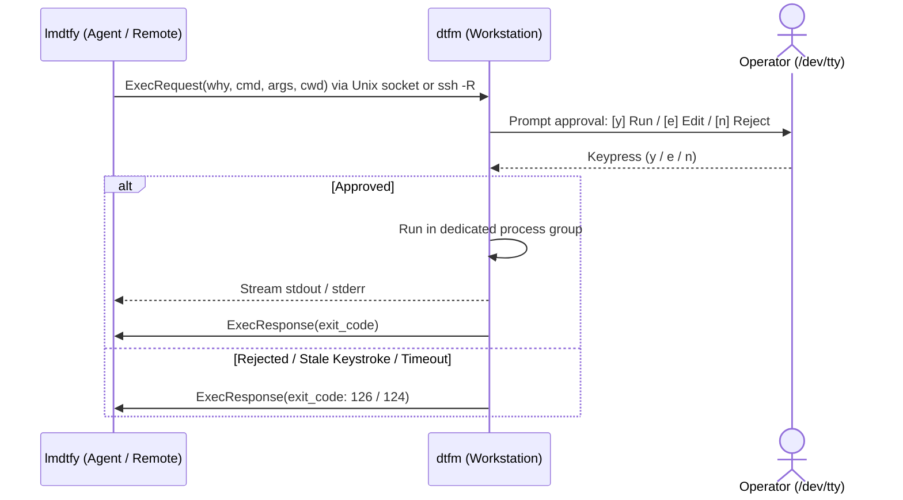

# dtfm & lmdtfy

Human-in-the-loop (HITL) execution gateway and CLI dispatcher for autonomous AI agents and remote engineers.

- `dtfm` (*Do That For Me*) runs on the operator's workstation, listening on a secure Unix domain socket and prompting the operator for approval before executing commands.
- `lmdtfy` (*Let Me Do That For You*) runs inside the agent's environment (local container, VM, or remote server over SSH), dispatching commands to `dtfm` with an explicit reason (`--why`).

---

## Architecture



- **Interactive Approvals**: Requests are displayed in POSIX shell syntax with stripped terminal control escapes and Trojan Source bidi characters.
- **Fail-Closed Security**: Dead stdin/EOF, stale keystrokes, and closed client connections immediately reject execution (exit code `126`). Custom environment variables are rejected upfront (`LD_*`, `PATH`, etc.).
- **Bounded Resources**: Stream messages capped at 4 MB; subprocess output buffers bounded to 1 MB.
- **Process Isolation**: Grandchild processes run in dedicated process groups and terminate on timeout or cancellation (`SIGKILL`).

---

## Installation & Build

### Prebuilt Binaries
Hermetic static binaries are available on [GitHub Releases](https://github.com/iinozemtsev-lab/dtfm/releases) for `darwin-arm64`, `darwin-amd64`, `linux-amd64`, and `linux-arm64`:
```bash
curl -fLO https://github.com/iinozemtsev-lab/dtfm/releases/download/v0.1.0/dtfm_0.1.0_linux_amd64.tar.gz
tar -xzf dtfm_0.1.0_linux_amd64.tar.gz && sudo install -m 0755 dtfm lmdtfy /usr/local/bin/
```

### Build from Source (Go 1.22+)
```bash
make        # Build local binaries in bin/
make test   # Run unit tests with race detection
make cross  # Cross-compile release binaries
```

---

## Quickstart

### 1. Operator: Start Approval Listener
```bash
# Listen on default socket (/run/user/<uid>/lmdtfy.sock on Linux, ~/.lmdtfy.sock on macOS)
dtfm
```

### 2. Connect Agent (Local or Remote)
- **Local Machine / Container**: `lmdtfy` connects automatically to the default socket path.
- **Remote Server over SSH**: Forward the socket securely using `dtfm ssh-config`:
  ```bash
  # Automatically configure ~/.ssh/config with the correct RemoteForward path:
  dtfm ssh-config dev-box --write
  ssh dev-box
  ```
  *(Or ad-hoc forward: `ssh -R /run/user/<remote_uid>/lmdtfy.sock:<local_socket> dev-box`)*

### 3. Agent: Check Connectivity & Execute
```bash
# Verify connection to active operator session (exit code 0 if ready, 2 if inactive)
lmdtfy ping

# Dispatch command for human review and execution
lmdtfy exec --why "Install project dependencies" npm install

# Custom working directory or review timeout (seconds)
lmdtfy exec --why "Run test suite" --cwd /opt/project --timeout 120 pytest
```

---

## CLI Reference

- `dtfm [--socket <path>]`: Start approval server on default socket (or specified path).
- `dtfm ssh-config <host> [-w|--write] [--socket <path>] [--config <path>]`: Generate or atomically write `~/.ssh/config` `RemoteForward` block.
- `lmdtfy ping [--socket <path>]`: Test operator listener connectivity.
- `lmdtfy exec --why "<reason>" [--socket <path>] [--timeout <sec>] [--cwd <path>] <cmd>...`: Dispatch command for human review.
- `dtfm --version` / `lmdtfy --version`: Display version information.

---

## Exit Codes

| Code | Meaning |
|:---:|---|
| `0` | Success (or exit code of executed command) |
| `1` | General CLI error or protocol violation |
| `2` | Session inactive (`dtfm` listener unreachable) |
| `124` | Execution or review timed out |
| `126` | Rejected by operator or denied by security policy |
| `127` | Command failed to start (not found or permission error) |
| `128+N` | Terminated by signal `N` (`SIGINT` = 130, `SIGKILL` = 137) |

---

## Releases & Changelog

- Maintainer release procedures: [docs/releasing.md](docs/releasing.md)
- Release history and notes: [CHANGELOG.md](CHANGELOG.md)

---

## License

[Apache 2.0](LICENSE) &copy; 2026 Ivan Inozemtsev
