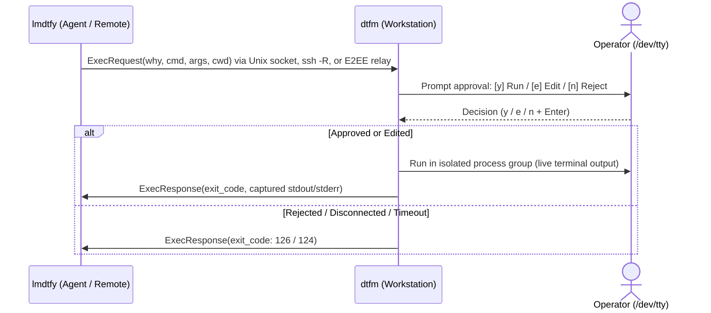

<p align="center">
  <picture>
    <source media="(prefers-color-scheme: dark)" srcset="assets/dtfm-logo-dark.jpg">
    <source media="(prefers-color-scheme: light)" srcset="assets/dtfm-logo-light.jpg">
    
  </picture>
</p>

# dtfm & lmdtfy

**Teleport your agent. Instantly. Precisely.**  
*Execute commands on your machine or servers from local or sandboxed AI agents — without sharing your credentials.*

- `dtfm` (*Do That For Me*) runs on your workstation or target host, listening over a local Unix socket or end-to-end encrypted (E2EE) WebSocket relay and prompting you for approval before running any command.
- `lmdtfy` (*Let Me Do That For You*) runs inside the agent's environment (local workstation or container, SSH-reachable VM, or cloud sandbox), dispatching commands to `dtfm` with an explicit reason (`--why`).

---

## Why dtfm?

Autonomous AI coding agents work best when they can run tools, test commands, and inspect environments directly. However, giving an agent full shell access or copying master credentials into an agent container creates severe security and operational friction. `dtfm` bridges this boundary with human-in-the-loop verification across three concrete developer scenarios:

- **Local privileged operations without passwordless `sudo`**: Local coding agents (such as `agy`, Claude Code, or Cursor) often need elevated privileges to install system packages, manage system services, or configure network interfaces. Granting passwordless `sudo` in `/etc/sudoers` or exposing host credentials to the agent process increases the attack surface of the local machine. With `dtfm`, the agent dispatches privileged commands via `lmdtfy exec --why ... sudo ...` over the local Unix domain socket. The operator reviews the request and enters their password directly on `/dev/tty`. The agent process never sees or handles the credentials.
- **Keep secrets out of agent sandboxes**: Workstations hold master cloud credentials (`gcloud`, `aws`, `kubectl`, `1Password`, `gh`), while AI agents run in sandboxes (Docker, VMs, Codespaces). Copying credentials into the sandbox is dangerous; manual copy-pasting breaks agent flow. `dtfm` lets the agent run `lmdtfy exec --why ...`, executing on the host after explicit terminal approval (`[y]`) with zero leaked tokens.
- **Supervised driving on remote servers**: Configure or debug a remote VPS (Nginx, systemd, firewall) with `dtfm` running in your SSH session — the agent does the heavy typing and diagnostics while you keep a foot on the brake via `[y] Run / [e] Edit / [n] Reject` rather than granting an LLM unchecked root or `sudo` access.

---

## Quickstart

### 1. Operator: Install & Start Approval Listener

Install the static `dtfm` binary into `~/.local/bin` (Linux & macOS, `amd64` & `arm64`):

```bash
os=$(uname -s | tr '[:upper:]' '[:lower:]')
arch=$(uname -m | sed -e 's/x86_64/amd64/' -e 's/aarch64/arm64/')
tmp=$(mktemp) && mkdir -p ~/.local/bin && \
  curl -fsSL "https://github.com/iinozemtsev-lab/dtfm/releases/latest/download/dtfm-${os}-${arch}" -o "$tmp" && \
  install -m 0755 "$tmp" ~/.local/bin/dtfm && rm -f "$tmp"
```

*(Ensure `~/.local/bin` is in your `$PATH`, or [build from source](#build-from-source-go-122) below.)*

Start the approval listener on your workstation:

```bash
# Listen on default socket (/run/user/<uid>/lmdtfy.sock on Linux, ~/.lmdtfy.sock on macOS)
dtfm
```

### 2. Connect Agent

<details open>
<summary><b>Agent on an SSH-Reachable VM / Server</b> — you can <code>ssh</code> from the <code>dtfm</code> host into the agent box</summary>

From the machine running `dtfm`, SSH into the agent host to reverse-forward the approval socket (no SSH keys or credentials are placed on the agent):

```bash
# Preview the config snippet (omit --write), or write it into ~/.ssh/config:
#   # Added by dtfm ssh-config
#   Host agent-vm
#       User ubuntu
#       RemoteForward /run/user/1000/lmdtfy.sock /Users/you/.lmdtfy.sock
#       StreamLocalBindUnlink yes
dtfm ssh-config ubuntu@agent-vm --write
ssh agent-vm
```

*(Or ad-hoc without editing `~/.ssh/config`: `ssh -o StreamLocalBindUnlink=yes -R /run/user/<remote_uid>/lmdtfy.sock:<local_socket> ubuntu@agent-vm`)*

</details>

<details>
<summary><b>Same Machine or Local Container (Local Coding Agents)</b> — shared local Unix socket</summary>

For local coding agents (such as `agy`, Claude Code, or Cursor) running on the same machine, zero extra setup is needed — `lmdtfy` connects automatically to the default local socket path (`/run/user/<uid>/lmdtfy.sock` on Linux, `~/.lmdtfy.sock` on macOS).

For container sandboxes, bind-mount a dedicated socket directory rather than a single file (e.g. start `dtfm --socket "$HOME/.dtfm/lmdtfy.sock"`, mount `-v "$HOME/.dtfm:/run/dtfm"`, and set `LMDTFY_SOCKET=/run/dtfm/lmdtfy.sock`, running the container with `--user "$(id -u):$(id -g)"` on Linux) so host `dtfm` restarts don't orphan the mounted socket inode.

</details>

<details>
<summary><b>Cloud Sandboxes &amp; NATs via WebSockets</b> — self-hosted DIY (hosted relay coming soon)</summary>

Bridge across NATs without inbound SSH using the included zero-knowledge E2EE `relay` server:

```bash
# 1. Run the stateless in-memory relay behind any HTTPS/WSS endpoint (default listen: :8088):
relay --listen 127.0.0.1:8088

# 2. Operator connects to the relay (prints E2EE pairing token and Magic Link):
dtfm --relay --relay-url wss://<relay-host>/ws

# 3. Agent connects using the Magic Link URL (end-to-end encrypted):
lmdtfy ping --relay "https://<relay-host>/c/<session-id>#<key>"
lmdtfy exec --relay "https://<relay-host>/c/<session-id>#<key>" --why "run migrations" make db-migrate
```

For production VPS deployment with systemd, Nginx, automated TLS, and auto-updates, see the [Self-Hosting Relay Runbook](docs/host_relay.md).

</details>

### 3. Hand Off to Your Agent

Paste this into your agent's chat (it will install `lmdtfy` if needed and verify connectivity):

```text
I have dtfm running. Read https://raw.githubusercontent.com/iinozemtsev-lab/dtfm/main/docs/lmdtfy_guide.md, install lmdtfy if needed, ping me to verify the connection, and route any privileged or host commands through it.
```

<details>
<summary><b>Or run <code>lmdtfy</code> directly from a shell</b></summary>

```bash
# Verify connection to active operator session (exit code 0 if ready, 2 if inactive)
lmdtfy ping

# Dispatch command for human review and execution
lmdtfy exec --why "Install project dependencies" npm install

# Custom working directory or review/execution timeout (seconds)
lmdtfy exec --why "Run test suite" --cwd /opt/project --timeout 120 pytest
```

</details>

When your agent dispatches a command, `dtfm` prompts on your terminal before anything runs:

```text
────────────────────────────────────────────────────────────
🔔 LMDTFY Command Execution Request:
   Reason:  Deploy staging worker
   Command: gcloud run deploy worker --region europe-west6
────────────────────────────────────────────────────────────
Approve execution? [y] Run  [e] Edit  [n] Reject:
```

When an approved command (`y` + `Enter`) invokes an authenticator like `sudo` or `ssh`, `dtfm` hands foreground `/dev/tty` control directly to it so you enter your password securely on your terminal without the agent process ever seeing it.

---

## Architecture



- **Interactive Approvals & Inline Editing**: Requests are displayed in lossless POSIX / ANSI-C (`$'...'`) shell syntax with visibly escaped terminal control codes and Trojan Source bidi characters. Operators can edit commands inline with Readline-style keybindings (`[e]`) before running, and pending TTY input is flushed prior to prompting so pre-typed keystrokes cannot auto-approve requests.
- **Fail-Closed Security**: Dead stdin/EOF, backgrounded TTYs, TTY input-flush errors, and closed client connections immediately reject execution (exit code `126`). Any custom environment variables are rejected upfront (e.g., `LD_*`, `PATH`).
- **Bounded Resources**: Request frames are capped at 4 MiB; captured `stdout` and `stderr` are bounded to 1 MiB per stream (16 MiB max serialized response envelope).
- **Controlling Terminal Handover (`TIOCSPGRP` / `Ctty`)**: When `dtfm` runs in the foreground on `/dev/tty`, approved child processes receive foreground terminal control (`TIOCSPGRP`). This lets authenticators like `sudo`, `ssh`, or `pinentry` prompt the operator directly on `/dev/tty` for passwords without triggering `SIGTTOU` or `SIGTTIN`, restoring original `termios` attributes (`TCSAFLUSH`) upon completion.
- **Input Sandboxing (`stdin` to `/dev/null`)**: Standard input of the child process is bound to `/dev/null` while authenticators access `/dev/tty` directly. Non-authenticating commands receive an immediate `EOF` rather than capturing unprompted keystrokes from the operator's terminal, with `stdout` and `stderr` mirrored live to the display.
- **Process Group Isolation**: Child and grandchild processes run in dedicated process groups and terminate on timeout or cancellation (`SIGKILL`).

> [!IMPORTANT]
> **Trust Model**: `dtfm` is a human-in-the-loop safety gate ("seatbelt") designed to prevent accidental misuse or unintended commands from AI agents in environments you control. Approved commands run **unsandboxed** with your local user privileges, and terminal sanitization is best-effort — **do not** expose or forward the `dtfm` socket (or share relay pairing links) with untrusted hosts or third parties, and always review commands before approving.

---

## Installation & Build

### Prebuilt Release Archives
Standalone static binaries and reproducible `.tar.gz` archives (`dtfm`, `lmdtfy`, and `relay`) with `SHA256SUMS` are published on [GitHub Releases](https://github.com/iinozemtsev-lab/dtfm/releases) for `darwin-arm64`, `darwin-amd64`, `linux-amd64`, and `linux-arm64`.

### Build from Source (Go 1.22+)
```bash
make build  # Build local static binaries in bin/
make test   # Run unit tests (-race) and script checks
make cross  # Cross-compile release binaries in bin/dist/
```

---

## CLI Reference

- `dtfm [--socket <path>]`: Start approval server on default socket (or specified path).
- `dtfm --relay [--relay-url <url>] [--hub-url <url>] [--session <id>]`: Start in-memory E2EE WebSocket relay session (`--relay-url` required when self-hosting).
- `dtfm ssh-config <host> [-w|--write] [--socket <path>] [--config <path>]`: Generate or atomically write `~/.ssh/config` `RemoteForward` block.
- `lmdtfy ping [--socket <path>] [--relay <token-or-url>] [--relay-url <url>]`: Test operator listener connectivity.
- `lmdtfy exec --why "<reason>" [--socket <path>] [--relay <token-or-url>] [--relay-url <url>] [--timeout <sec>] [--cwd <path>] <cmd>...`: Dispatch command for human review (`--timeout` defaults to `300` seconds, max `86400`, bounding review and execution separately).
- `relay [--listen <addr>] [--idle-timeout <dur>] [--max-sessions <n>] [--max-sessions-per-ip <n>] [--trusted-proxies <cidrs>] [--verbose]`: Standalone in-memory WebSocket streaming relay server (`cmd/relay`).
- `dtfm --version` / `lmdtfy --version` / `relay --version`: Display version information.

### Environment Variables

| Variable | Applies To | Description |
|---|---|---|
| `LMDTFY_SOCKET` | `dtfm`, `lmdtfy` | Default socket path when `--socket` flag is omitted |
| `LMDTFY_RELAY` | `lmdtfy` | Default relay token or URL when `--relay` flag is omitted |
| `LMDTFY_RELAY_URL` | `lmdtfy` | Default relay endpoint URL when `--relay-url` flag is omitted |
| `NO_COLOR` | `dtfm` | Disable ANSI colors in interactive terminal prompts when non-empty |

---

## Exit Codes

Approved commands forward the executed process's exit code (`0–255`) verbatim. Gateway-specific exit codes:

| Code | Meaning |
|:---:|---|
| `0` | Success (`ping` active, or approved command exited `0`) |
| `1` | General CLI error or protocol violation |
| `2` | Session inactive (`dtfm` listener unreachable) |
| `124` | Execution or review timed out |
| `126` | Rejected by operator or denied by security policy |
| `127` | Command failed to start (not found or permission error) |
| `128+N` | Terminated by signal `N` (`SIGINT` = 130, `SIGKILL` = 137) |

---

## Documentation & Releases

- Agent onboarding manual: [docs/lmdtfy_guide.md](docs/lmdtfy_guide.md)
- Self-hosting relay runbook: [docs/host_relay.md](docs/host_relay.md)
- Maintainer release procedures: [docs/releasing.md](docs/releasing.md)
- Release history and notes: [CHANGELOG.md](CHANGELOG.md)

---

## License

[Apache 2.0](LICENSE) &copy; 2026 Ivan Inozemtsev
