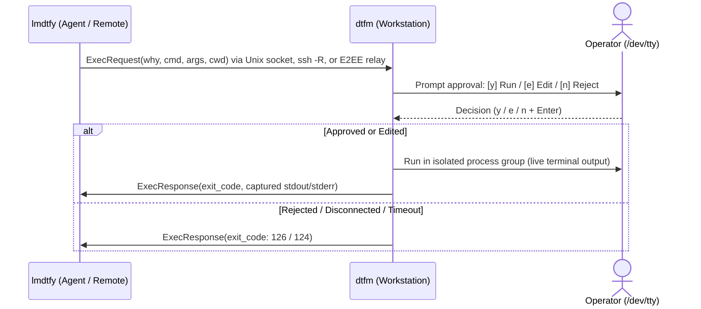

<p align="center">
  <picture>
    <source media="(prefers-color-scheme: dark)" srcset="assets/dtfm-logo-dark.jpg">
    <source media="(prefers-color-scheme: light)" srcset="assets/dtfm-logo-light.jpg">
    
  </picture>
</p>

# dtfm & lmdtfy

**Let sandboxed AI agents run privileged commands—with your `[y]` approval.**

Keep `sudo`, SSH keys, and cloud tokens (`aws`, `gcloud`, `kubectl`) on your machine—never inside the agent's container or VM. When the agent needs a privileged or host command, **`lmdtfy`** (*Let Me Do That For You*) sends it to your terminal (**`dtfm`**, *Do That For Me*), where you inspect it, press `[y]`, and authenticate locally.

<table>
<tr>
<th>Agent Sandbox · <code>lmdtfy</code></th>
<th>Your Terminal · <code>dtfm</code></th>
</tr>
<tr>
<td valign="top">

```bash
$ lmdtfy exec \
    --why "Restart Nginx after updating TLS config" \
    -- sudo systemctl restart nginx
```

</td>
<td valign="top">

```text
──────────────────────────────────────────────────
🔔 LMDTFY Command Execution Request:
   Reason:  Restart Nginx after updating TLS config
   Command: sudo systemctl restart nginx
──────────────────────────────────────────────────
Approve execution? [y] Run  [e] Edit  [n] Reject: y
⚡ Executing: sudo systemctl restart nginx
[sudo] password for ivan:
✅ Command succeeded (exit code 0, 142ms)
```

</td>
</tr>
</table>

> **Zero-credential handoff:** `sudo`, `ssh`, `gpg`, and Touch ID (`pam_tid`) read your password or prompt directly from `/dev/tty`—neither `dtfm` nor `lmdtfy` ever sees your credentials.

---

## Why dtfm?

- **Local `sudo` without `NOPASSWD`**: Gate `apt`, `systemctl`, or `ufw` behind `[y]` and your password or Touch ID instead of granting passwordless `sudo` to coding agents (`agy`, Claude Code, Cursor).
- **Keep cloud keys out of sandboxes**: Keep `gcloud`, `aws`, `kubectl`, `1Password`, and `gh` on your laptop while agents run in Docker, VMs, or cloud workspaces.
- **Supervised remote ops**: Let agents administer a VPS over `ssh` while you inspect, `[e]` edit, or `[n]` reject every command before it runs.

---

## Quickstart

### 1. Install `dtfm` & `lmdtfy`

Install both static binaries into `~/.local/bin` (or `/usr/local/bin` when run as root) with SHA-256 checksum verification (Linux & macOS, `amd64` & `arm64`):

```bash
curl -fsSL https://raw.githubusercontent.com/iinozemtsev-lab/dtfm/main/scripts/install.sh | sh
```

*(Agent sandbox only: append `sh -s -- lmdtfy`. Relay server only: `sh -s -- relay`, which installs `dtfm-relay`. See [Installation & Build](#installation--build) for pinned versions, custom `--dir`, and building from source.)*

### 2. Connect Operator & Agent

<details open>
<summary><b>Magic Link (Containers, Cloud Sandboxes &amp; NATs)</b> — zero-knowledge E2EE WebSocket relay</summary>

1. Start a relay session on your workstation (connects to `wss://relay.dtfm.dev/ws` by default):
   ```bash
   dtfm --relay
   ```
   `dtfm` prints an **Agent Magic Link** (`https://dtfm.dev/c/<session-id>#<key>`). The `#<key>` fragment never leaves your machines.

2. Paste one line into your agent's chat:
   ```text
   Read https://raw.githubusercontent.com/iinozemtsev-lab/dtfm/main/docs/agent.md and use <magic-link> to run privileged commands via lmdtfy.
   ```

> **Public Relay (`relay.dtfm.dev`)**: Provided free and as-is on a best-effort basis with zero disk logging and no uptime SLA. For production or team reliance, [self-host `dtfm-relay`](docs/host_relay.md) on your own VPS and pass `--relay-url wss://<your-relay>/ws`.

</details>

<details>
<summary><b>Agent on an SSH-Reachable VM / Server</b> — reverse-forward Unix socket over <code>ssh -R</code></summary>

From the machine running `dtfm`, SSH into the agent host to reverse-forward the approval socket (no SSH keys or credentials are placed on the agent):

```bash
# Start listener locally:
dtfm

# In another terminal, configure ~/.ssh/config and connect:
dtfm ssh-config ubuntu@agent-vm --write
ssh agent-vm
```

*(Or ad-hoc without editing `~/.ssh/config`: `ssh -o StreamLocalBindUnlink=yes -R /run/user/<remote_uid>/lmdtfy.sock:<local_socket> ubuntu@agent-vm`)*

</details>

<details>
<summary><b>Same Machine or Local Container</b> — shared local Unix socket</summary>

For local coding agents (`agy`, Claude Code, Cursor) on the same machine, run `dtfm` with no flags—`lmdtfy` connects automatically to `/run/user/<uid>/lmdtfy.sock` (Linux) or `~/.lmdtfy.sock` (macOS).

For container sandboxes, bind-mount a dedicated socket directory rather than a single file (e.g., start `dtfm --socket "$HOME/.dtfm/lmdtfy.sock"`, mount `-v "$HOME/.dtfm:/run/dtfm"`, and set `LMDTFY_SOCKET=/run/dtfm/lmdtfy.sock`, running the container with `--user "$(id -u):$(id -g)"` on Linux) so host `dtfm` restarts don't orphan the mounted socket inode.

</details>

### 3. Hand Off to Your Agent (Local / SSH Socket)

Paste this into your agent's chat:

```text
I have dtfm running. Read https://raw.githubusercontent.com/iinozemtsev-lab/dtfm/main/docs/agent.md, install lmdtfy if needed, ping me to verify the connection, and route any privileged or host commands through it.
```

<details>
<summary><b>Or run <code>lmdtfy</code> directly from a shell</b></summary>

```bash
# Verify connection to active operator session (exit code 0 if ready, 2 if inactive)
lmdtfy ping

# Dispatch command for human review and execution
lmdtfy exec --why "Install project dependencies" -- npm install

# Custom working directory or review/execution timeout (seconds)
lmdtfy exec --why "Run test suite" --cwd /opt/project --timeout 120 -- pytest
```

</details>

---

## Architecture & Security



- **TTY & Stdin Isolation (`TIOCSPGRP`)**: Child `stdin` is bound to `/dev/null` while authenticators (`sudo`, `ssh`, `gpg`, `pam_tid`) receive foreground `/dev/tty` control directly, restoring `termios` (`TCSAFLUSH`) on exit.
- **Zero-Knowledge `#fragment` E2EE**: Bilateral 32-byte nonces + `HKDF-SHA256` + `AES-256-GCM` (with session-ID AAD) derive keys from `#<key>`, which is never transmitted. `dtfm-relay` routes ciphertext in RAM with zero disk state.
- **Anti-Spoofing Terminal Prompt**: Single-line requests support `[e]` inline Readline editing; multiline scripts render with numbered gutters (`[y]` Run / `[n]` Reject). ANSI/CSI sequences and Trojan Source bidi/control characters are escaped, and pending TTY input is flushed (`TCFLSH`/`TIOCFLUSH`) before prompting.
- **Fail-Closed & Bounded**: Dead stdin/EOF, TTY flush errors, disconnects, and custom environment variables reject immediately (`126`). Requests are capped at 4 MiB; captured `stdout`/`stderr` are bounded to 1 MiB per stream.

> [!IMPORTANT]
> **Execution Trust Boundary**: `dtfm` is a human-in-the-loop seatbelt, not a sandbox. Approved commands run **unsandboxed** on your host with your local user's privileges—only pair with your own agent sessions, and always read the command and `--why` before pressing `y`.

---

## Installation & Build

### Installer Script (Recommended)

```bash
# Default: install dtfm and lmdtfy to ~/.local/bin (or /usr/local/bin as root)
curl -fsSL https://raw.githubusercontent.com/iinozemtsev-lab/dtfm/main/scripts/install.sh | sh

# Install only lmdtfy (e.g., inside an agent container), or install dtfm-relay
curl -fsSL https://raw.githubusercontent.com/iinozemtsev-lab/dtfm/main/scripts/install.sh | sh -s -- lmdtfy
curl -fsSL https://raw.githubusercontent.com/iinozemtsev-lab/dtfm/main/scripts/install.sh | sudo sh -s -- --dir /usr/local/bin relay
```

### Prebuilt Release Archives & SLSA Verification

Standalone static binaries (`CGO_ENABLED=0`) and reproducible `.tar.gz` archives (`dtfm`, `lmdtfy`, and `relay`) with `SHA256SUMS` and SLSA v1.0 provenance are published on [GitHub Releases](https://github.com/iinozemtsev-lab/dtfm/releases) for `darwin-arm64`, `darwin-amd64`, `linux-amd64`, and `linux-arm64`:

```bash
gh attestation verify ~/.local/bin/dtfm --repo iinozemtsev-lab/dtfm
```

### Build from Source (Go 1.22+)

```bash
make build  # Build local static binaries in bin/
make test   # Run unit tests (-race) and script checks
make cross  # Cross-compile release binaries in bin/dist/
```

---

## CLI Reference

- `dtfm [--socket <path>]`: Start approval server on default socket (or specified path).
- `dtfm --relay [--relay-url <url>] [--hub-url <url>] [--session <id>]`: Start in-memory E2EE WebSocket relay session (defaults to `wss://relay.dtfm.dev/ws`; `--relay-url` overrides for self-hosting).
- `dtfm ssh-config <host> [-w|--write] [--socket <path>] [--config <path>]`: Generate or atomically write `~/.ssh/config` `RemoteForward` block.
- `lmdtfy ping [--socket <path>] [--relay <token-or-url>] [--relay-url <url>]`: Test operator listener connectivity.
- `lmdtfy exec --why "<reason>" [--socket <path>] [--relay <token-or-url>] [--relay-url <url>] [--timeout <sec>] [--cwd <path>] -- <cmd>...`: Dispatch command for human review (`--timeout` defaults to `300` seconds, max `86400`, bounding review and execution separately).
- `dtfm-relay [--listen <addr>] [--idle-timeout <dur>] [--max-sessions <n>] [--max-sessions-per-ip <n>] [--trusted-proxies <cidrs>] [--verbose]`: Standalone in-memory WebSocket streaming relay server (`cmd/relay`, published as `relay-<os>-<arch>`).
- `dtfm --version` / `lmdtfy --version` / `dtfm-relay --version`: Display version information.

### Environment Variables

| Variable | Applies To | Description |
|---|---|---|
| `LMDTFY_SOCKET` | `dtfm`, `lmdtfy` | Default socket path when `--socket` flag is omitted |
| `LMDTFY_RELAY` | `lmdtfy` | Default relay token or URL when `--relay` flag is omitted |
| `LMDTFY_RELAY_URL` | `lmdtfy` | Default relay endpoint URL when `--relay-url` flag is omitted |
| `NO_COLOR` | `dtfm` | Disable ANSI colors in interactive terminal prompts when non-empty |

---

## Exit Codes

Approved commands forward the executed process's exit code (`0–255`) verbatim. Gateway-specific exit codes:

| Code | Meaning |
|:---:|---|
| `0` | Success (`ping` active, or approved command exited `0`) |
| `1` | General CLI error or protocol violation |
| `2` | Session inactive (`dtfm` listener unreachable) |
| `124` | Execution or review timed out |
| `126` | Rejected by operator or denied by security policy |
| `127` | Command failed to start (not found or permission error) |
| `128+N` | Terminated by signal `N` (`SIGINT` = 130, `SIGKILL` = 137) |

---

## Documentation & Releases

- Agent operational guide: [docs/agent.md](docs/agent.md)
- Self-hosting relay runbook: [docs/host_relay.md](docs/host_relay.md)
- Maintainer release procedures: [docs/releasing.md](docs/releasing.md)
- Release history and notes: [CHANGELOG.md](CHANGELOG.md)

---

## License

[Apache 2.0](LICENSE) &copy; 2026 Ivan Inozemtsev
