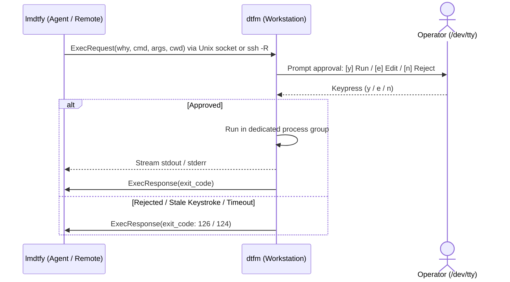

# dtfm & lmdtfy

**Teleport your agent. Instantly. Precisely.**  
*Execute commands on your machine or servers from sandboxed AI agents — without sharing your credentials.*

Human-in-the-loop (HITL) execution gateway and CLI dispatcher for autonomous AI agents and remote engineers:

- `dtfm` (*Do That For Me*) runs on the operator's workstation, listening on a secure Unix domain socket and prompting the operator for approval before executing commands.
- `lmdtfy` (*Let Me Do That For You*) runs inside the agent's environment (local container, VM, or remote server over SSH), dispatching commands to `dtfm` with an explicit reason (`--why`).

---

## Why dtfm?

Autonomous AI coding agents work best when they can run tools, test commands, and inspect environments directly. However, giving an agent full shell access or copying master credentials into an agent container creates severe security and operational friction. `dtfm` bridges this boundary with human-in-the-loop verification across three concrete developer scenarios:

- **Keep secrets out of agent sandboxes (The Cloud CLI Dilemma)**: Workstations hold master cloud credentials (`gcloud`, `aws`, `kubectl`, `1Password`, `gh`), while AI agents run in sandboxes (Docker, VMs, Codespaces). Copying credentials into the sandbox is dangerous; manual copy-pasting breaks agent flow. `dtfm` allows the agent to run `lmdtfy exec --why ...`, executing on the host with 1-click approval (`[y]`) and zero leaked tokens.
- **Supervised driving on remote servers ("Tool Proxy / Admin Session")**: Tweaking a remote VPS (Nginx, systemd, firewall). The agent does the heavy typing and thinking, but the human keeps a foot on the brake via `[y] Run / [e] Edit / [n] Reject` rather than giving an LLM unchecked root/sudo SSH access.
- **Zero-trust remote pairing & assistance**: Assisting a peer or family member with terminal tasks with per-command confirmation instead of clumsy screen-sharing or wide-open SSH.

---

## Architecture



- **Interactive Approvals**: Requests are displayed in POSIX shell syntax with stripped terminal control escapes and Trojan Source bidi characters.
- **Fail-Closed Security**: Dead stdin/EOF, stale keystrokes, and closed client connections immediately reject execution (exit code `126`). Custom environment variables are rejected upfront (`LD_*`, `PATH`, etc.).
- **Bounded Resources**: Stream messages capped at 4 MB; subprocess output buffers bounded to 1 MB.
- **Process Isolation**: Grandchild processes run in dedicated process groups and terminate on timeout or cancellation (`SIGKILL`).

> [!IMPORTANT]
> **Trust Model**: `dtfm` is a human-in-the-loop safety gate ("seatbelt") designed to prevent accidental misuse or unintended commands from AI agents in environments you control. Approved commands run **unsandboxed** with your local user privileges, and terminal sanitization is best-effort — **do not** expose or forward the `dtfm` socket to untrusted hosts or third parties, and always review commands before approving.

---

## Installation & Build

### Prebuilt Binaries
Hermetic static binaries are available on [GitHub Releases](https://github.com/iinozemtsev-lab/dtfm/releases) for `darwin-arm64`, `darwin-amd64`, `linux-amd64`, and `linux-arm64`:
```bash
curl -fLO https://github.com/iinozemtsev-lab/dtfm/releases/download/v0.2.0/dtfm_0.2.0_linux_amd64.tar.gz
mkdir -p ~/.local/bin
tar -xzf dtfm_0.2.0_linux_amd64.tar.gz dtfm lmdtfy
install -m 0755 dtfm lmdtfy ~/.local/bin/ && rm -f dtfm lmdtfy dtfm_0.2.0_linux_amd64.tar.gz
```

*(Ensure `~/.local/bin` is in your `$PATH`.)*

### Build from Source (Go 1.22+)
```bash
make        # Build local binaries in bin/
make test   # Run unit tests with race detection
make cross  # Cross-compile release binaries
```

---

## Quickstart

### 1. Operator: Start Approval Listener
```bash
# Listen on default socket (/run/user/<uid>/lmdtfy.sock on Linux, ~/.lmdtfy.sock on macOS)
dtfm
```

### 2. Connect Agent

<details open>
<summary><b>Agent on an SSH-Reachable VM / Server</b> — you can <code>ssh</code> from the <code>dtfm</code> host into the agent box</summary>

From the machine running `dtfm`, SSH into the agent host to reverse-forward the approval socket (no SSH keys or credentials are placed on the agent):

```bash
# Preview the config snippet (omit --write), or write it into ~/.ssh/config:
#   # Added by dtfm ssh-config
#   Host agent-vm
#       User ubuntu
#       RemoteForward /run/user/1000/lmdtfy.sock /Users/you/.lmdtfy.sock
#       StreamLocalBindUnlink yes
dtfm ssh-config ubuntu@agent-vm --write
ssh agent-vm
```

*(Or ad-hoc without editing `~/.ssh/config`: `ssh -R /run/user/<remote_uid>/lmdtfy.sock:<local_socket> ubuntu@agent-vm`)*

</details>

<details>
<summary><b>Same Machine or Local Container</b> — shared local Unix socket</summary>

`lmdtfy` connects automatically to the default local socket path (for containers, bind-mount the socket and set `LMDTFY_SOCKET` if UIDs differ).

</details>

<details>
<summary><b>Cloud Sandboxes &amp; NATs via WebSockets</b> — self-hosted DIY (hosted relay coming soon)</summary>

Bridge across NATs without inbound SSH using the included zero-knowledge E2EE `relay` server:

```bash
# 1. Run the stateless in-memory relay on any HTTPS/WSS endpoint:
relay --listen 127.0.0.1:8080

# 2. Operator connects to the relay (prints E2EE pairing token and Magic Link):
dtfm --relay --relay-url wss://<relay-host>/ws

# 3. Agent connects using the Magic Link URL (end-to-end encrypted):
lmdtfy ping --relay "https://<relay-host>/c/<session-id>#<key>"
lmdtfy exec --relay "https://<relay-host>/c/<session-id>#<key>" --why "run migrations" make db-migrate
```

</details>

### 3. Agent: Check Connectivity & Execute
```bash
# Verify connection to active operator session (exit code 0 if ready, 2 if inactive)
lmdtfy ping

# Dispatch command for human review and execution
lmdtfy exec --why "Install project dependencies" npm install

# Custom working directory or review timeout (seconds)
lmdtfy exec --why "Run test suite" --cwd /opt/project --timeout 120 pytest
```

---

## CLI Reference

- `dtfm [--socket <path>]`: Start approval server on default socket (or specified path).
- `dtfm --relay [--relay-url <url>] [--hub-url <url>] [--session <id>]`: Start in-memory E2EE WebSocket relay session.
- `dtfm ssh-config <host> [-w|--write] [--socket <path>] [--config <path>]`: Generate or atomically write `~/.ssh/config` `RemoteForward` block.
- `lmdtfy ping [--socket <path>] [--relay <token-or-url>] [--relay-url <url>]`: Test operator listener connectivity.
- `lmdtfy exec --why "<reason>" [--socket <path>] [--relay <token-or-url>] [--relay-url <url>] [--timeout <sec>] [--cwd <path>] <cmd>...`: Dispatch command for human review.
- `relay [--listen <addr>] [--idle-timeout <dur>] [--max-sessions <n>] [--max-sessions-per-ip <n>] [--trusted-proxies <cidrs>]`: Standalone in-memory WebSocket streaming relay server (`cmd/relay`).
- `dtfm --version` / `lmdtfy --version`: Display version information.

### Environment Variables

| Variable | Description |
|---|---|
| `LMDTFY_SOCKET` | Default socket path when `--socket` flag is omitted |
| `LMDTFY_RELAY` | Default relay token or URL when `--relay` flag is omitted |
| `LMDTFY_RELAY_URL` | Default relay endpoint URL when `--relay-url` flag is omitted |

---

## Exit Codes

| Code | Meaning |
|:---:|---|
| `0` | Success (or exit code of executed command) |
| `1` | General CLI error or protocol violation |
| `2` | Session inactive (`dtfm` listener unreachable) |
| `124` | Execution or review timed out |
| `126` | Rejected by operator or denied by security policy |
| `127` | Command failed to start (not found or permission error) |
| `128+N` | Terminated by signal `N` (`SIGINT` = 130, `SIGKILL` = 137) |

---

## Documentation & Releases

- Agent onboarding manual: [docs/lmdtfy_guide.md](docs/lmdtfy_guide.md)
- Maintainer release procedures: [docs/releasing.md](docs/releasing.md)
- Release history and notes: [CHANGELOG.md](CHANGELOG.md)

---

## License

[Apache 2.0](LICENSE) &copy; 2026 Ivan Inozemtsev
