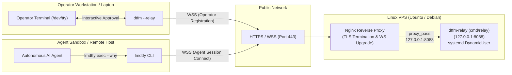

# Self-Hosting Relay Runbook: `cmd/relay`

Production runbook for self-hosting the stateless, zero-knowledge `dtfm-relay` server on a Linux VPS (targeting Ubuntu LTS / Debian with `systemd`, `nginx`, and automated TLS).

---

## 1. Overview & Architecture

`cmd/relay` (`dtfm-relay`) is an in-memory, zero-database WebSocket pairing hub that bridges operators (`dtfm`) and sandboxed AI coding agents (`lmdtfy`) across NATs, firewalls, and cloud environments without opening inbound ports on developer machines.



### Key Security & Operational Guarantees

- **Zero-Knowledge End-to-End Encryption (E2EE)**: The relay server never sees plaintext commands, arguments, reasons, or output. Cryptographic keys are derived on client machines via HKDF-SHA256 and carried exclusively in the URL fragment (`#<key>`), which is never transmitted to the relay server over HTTP or WebSocket headers.
- **Zero Persistent State**: The relay operates entirely in memory with no database (no SQLite, Postgres, or Redis), no disk storage, and no stateful configuration. If restarted, sessions cleanly disconnect and reconnect.
- **Sandboxed Execution**: Runs under systemd with `DynamicUser=yes`, `NoNewPrivileges=yes`, `ProtectSystem=strict`, and empty Linux capabilities (`CapabilityBoundingSet=`), listening strictly on `127.0.0.1:8088`.
- **Built-in Rate Limiting & DoS Protection**: Hardened against abuse with concurrent session limits (`--max-sessions 10000`), per-IP limits (`--max-sessions-per-ip 64`), idle session sweeping (`--idle-timeout 10m`), trusted proxy CIDR inspection, and 5 MB frame caps for untrusted agents.

---

## 2. Agent-Assisted Fast Path

If you are using an AI coding agent (e.g., Claude Code, `agy`, Cursor, Aider) on your local workstation to configure the VPS, you do not need to give the agent SSH credentials or root access to the remote server.

Instead, start `dtfm` on the VPS via an SSH socket forward from your laptop in a single command, then hand a 1-line instruction to your local agent.

### Step 1: Start `dtfm` on the VPS from Your Laptop

Run this one-shot command in a terminal on your developer laptop:

**Linux Operator Laptop:**
```bash
ssh -t -o StreamLocalBindUnlink=yes \
  -L "${XDG_RUNTIME_DIR:-/run/user/$(id -u)}/lmdtfy.sock:/run/user/1000/lmdtfy.sock" \
  <vps-user>@<vps-ip> "dtfm"
```

**macOS Operator Laptop:**
```bash
ssh -t -o StreamLocalBindUnlink=yes \
  -L "$HOME/.lmdtfy.sock:/run/user/1000/lmdtfy.sock" \
  <vps-user>@<vps-ip> "dtfm"
```

*(Replace `<vps-user>` and `<vps-ip>` with your VPS login and IP address. Adjust the remote UID `/run/user/1000/` if your remote user has a different UID).*

> [!NOTE]
> If `dtfm` is not yet installed on your VPS, install it in one command before running:
> ```bash
> ssh <vps-user>@<vps-ip> 'mkdir -p ~/.local/bin && tmp="$(mktemp)" && curl -fsSL "https://github.com/iinozemtsev-lab/dtfm/releases/latest/download/dtfm-$(uname -s | tr "[:upper:]" "[:lower:]")-$(uname -m | sed -e "s/x86_64/amd64/" -e "s/aarch64/arm64/")" -o "$tmp" && install -m 0755 "$tmp" ~/.local/bin/dtfm && rm -f "$tmp"'
> ```

### Step 2: The 1-Line Agent Prompt

Paste this into your local agent's chat:

```text
You have access to lmdtfy on this machine. Read docs/host_relay.md and execute all provisioning, installation, systemd, nginx, and verification steps on the VPS using `lmdtfy exec --why "<reason>" -- <cmd>`. Target domain: relay.example.com.
```

### Step 3: Human-in-the-Loop Review

As your agent dispatches commands, each request appears interactively on your laptop terminal where the VPS `dtfm` instance is running:

```text
────────────────────────────────────────────────────────────
🔔 LMDTFY Command Execution Request:
   Reason:  Install Nginx and Certbot for relay reverse proxy
   Command: sudo apt-get update && sudo apt-get install -y nginx certbot python3-certbot-nginx
────────────────────────────────────────────────────────────
Approve execution? [y] Run  [e] Edit  [n] Reject:
```

When `sudo` prompts for a password on the VPS, `dtfm` hands foreground `/dev/tty` control directly to `sudo` so you enter your password securely on your terminal. The agent process never sees your password or SSH keys.

---

## 3. Prerequisites & Expected DNS

Before configuring the relay, ensure your domain and firewall are ready.

### Domain Name System (DNS) Records

Configure the following records with your DNS provider (e.g., Cloudflare, Route53, Namecheap):

| Record Type | Host | Target / Value | Description |
|---|---|---|---|
| `A` | `relay` (or `relay.example.com`) | `<vps-ip>` (e.g. `203.0.113.10`) | VPS public IPv4 address |
| `AAAA` *(optional)* | `relay` (or `relay.example.com`) | `<vps-ipv6>` (e.g. `2001:db8::10`) | VPS public IPv6 address |

*(Replace `relay.example.com` with your actual subdomain and `<vps-ip>` with your VPS IP address).*

### Firewall & Open Ports

The VPS requires only two inbound public ports:

- `80/tcp` (HTTP): Used for Let's Encrypt ACME HTTP-01 domain challenge and HTTP-to-HTTPS redirect.
- `443/tcp` (HTTPS / WSS): Primary TLS-terminated WebSocket relay endpoint and health check.
- `22/tcp` (or your custom SSH port): For administrative SSH access.

Port `8088` (the `dtfm-relay` backend port) must **never** be opened in the firewall; it binds strictly to the loopback interface (`127.0.0.1:8088`).

**Example UFW (Uncomplicated Firewall) Setup:**
```bash
sudo ufw default deny incoming
sudo ufw default allow outgoing
sudo ufw allow OpenSSH
sudo ufw allow 80/tcp comment 'ACME HTTP-01 challenge and HTTPS redirect'
sudo ufw allow 443/tcp comment 'dtfm relay HTTPS and WebSocket'
sudo ufw enable
```

### Cloudflare Proxy (Orange Cloud) vs. DNS-Only (Grey Cloud)

- **DNS-Only (Grey Cloud — Recommended for simplicity)**: Direct TCP connection from clients to your VPS. Nginx handles Let's Encrypt certificate issuance directly via HTTP-01 challenges, and clients connect with standard low-latency WebSockets.
- **Cloudflare Proxied (Orange Cloud)**:
  - **WebSocket Support**: WebSockets are supported out of the box on port 443 across all Cloudflare tiers without extra configuration.
  - **100-Second Idle Timeout**: Cloudflare automatically terminates idle WebSocket connections if no traffic is exchanged for 100 seconds. `cmd/relay` and clients implement automated WebSocket ping/pong frames every 81 seconds (`pingPeriod = 81s`, `pongWait = 90s`), keeping connections open reliably through the Cloudflare proxy.
  - **TLS Modes**: Set Cloudflare SSL/TLS encryption mode to **Full (Strict)**. You can either issue a Let's Encrypt certificate via Certbot (HTTP-01 passes through the proxy) or install a free 15-year Cloudflare Origin CA certificate on Nginx.
  - **Real Client IPs**: When proxied through Cloudflare, Nginx receives Cloudflare proxy IPs in `remote_addr`. The Nginx configuration below forwards the true client IP via `X-Forwarded-For` and `X-Real-IP`.

---

## 4. Install `relay` Binary

The `cmd/relay` binary is distributed as a hermetic static executable (`CGO_ENABLED=0`) compiled for Linux (`amd64` and `arm64`) and published on [GitHub Releases](https://github.com/iinozemtsev-lab/dtfm/releases).

### 1-Line Verified Installation

Run this snippet on the VPS to detect architecture, download the latest release binary alongside `SHA256SUMS`, cryptographically verify the checksum, and install to `/usr/local/bin/dtfm-relay`:

```bash
OS="$(uname -s | tr '[:upper:]' '[:lower:]')" && \
ARCH="$(uname -m | sed -e 's/x86_64/amd64/' -e 's/aarch64/arm64/')" && \
TMP_DIR="$(mktemp -d)" && \
(
  cd "$TMP_DIR" && \
  curl -fsSLO "https://github.com/iinozemtsev-lab/dtfm/releases/latest/download/relay-${OS}-${ARCH}" && \
  curl -fsSLO "https://github.com/iinozemtsev-lab/dtfm/releases/latest/download/SHA256SUMS" && \
  sha256sum --check --ignore-missing SHA256SUMS && \
  sudo install -m 0755 "relay-${OS}-${ARCH}" /usr/local/bin/dtfm-relay
) && rm -rf "$TMP_DIR"
```

### Verify Binary Installation

Confirm the binary is installed and executable:

```bash
/usr/local/bin/dtfm-relay --version
```

Expected output:
```text
dtfm-relay v0.3.0
```

---

## 5. Sandboxed `systemd` Service

Create a hardened `systemd` unit that isolates the relay process with zero unnecessary privileges, unprivileged dynamic user execution, and restricted kernel/filesystem access.

### Create `/etc/systemd/system/dtfm-relay.service`

Write the unit file using `sudo tee`:

```bash
sudo tee /etc/systemd/system/dtfm-relay.service <<'EOF'
[Unit]
Description=dtfm relay server (stateless in-memory WebSocket pairing hub)
Documentation=https://github.com/iinozemtsev-lab/dtfm
After=network.target

[Service]
Type=simple
ExecStart=/usr/local/bin/dtfm-relay --listen 127.0.0.1:8088 --idle-timeout 10m --max-sessions 10000 --max-sessions-per-ip 64 --trusted-proxies 127.0.0.0/8,::1/128
Restart=always
RestartSec=5s

# Process Sandboxing & Hardening
DynamicUser=yes
NoNewPrivileges=yes
ProtectSystem=strict
ProtectHome=yes
PrivateTmp=yes
PrivateDevices=yes
ProtectKernelTunables=yes
ProtectKernelModules=yes
ProtectControlGroups=yes
RestrictAddressFamilies=AF_INET AF_INET6 AF_UNIX
RestrictNamespaces=yes
RestrictRealtime=yes
RestrictSUIDSGID=yes
MemoryDenyWriteExecute=yes
LockPersonality=yes
CapabilityBoundingSet=
AmbientCapabilities=
LimitNOFILE=65536

[Install]
WantedBy=multi-user.target
EOF
```

### Key Service Options Explained

| Parameter | Value | Security & Operational Purpose |
|---|---|---|
| `--listen` | `127.0.0.1:8088` | Binds strictly to local IPv4 loopback; never accessible directly from public internet. |
| `--idle-timeout` | `10m` | Automatically evicts abandoned sessions from memory after 10 minutes of inactivity. |
| `--max-sessions` | `10000` | Limits total concurrent in-memory sessions to prevent memory exhaustion. |
| `--max-sessions-per-ip` | `64` | Rate-limits registrations per remote client IP address. |
| `--trusted-proxies` | `127.0.0.0/8,::1/128` | Trusts reverse proxy headers (`X-Forwarded-For`, `X-Real-IP`) only from local Nginx. |
| `DynamicUser=yes` | `yes` | Allocates a transient, unprivileged UID/GID dynamically at startup; no persistent user account needed. |
| `ProtectSystem=strict` | `strict` | Mounts `/usr`, `/boot`, `/etc`, and system directories strictly read-only. |
| `CapabilityBoundingSet=` | *(empty)* | Drops all POSIX capabilities (no `CAP_NET_BIND_SERVICE`, no `CAP_SYS_ADMIN`, etc.). |
| `LimitNOFILE` | `65536` | Increases file descriptor limit to handle thousands of concurrent WebSocket client connections. |

### Enable and Start the Service

```bash
sudo systemctl daemon-reload
sudo systemctl enable --now dtfm-relay
sudo systemctl status dtfm-relay
```

### Local Health Verification

Verify that the relay is listening and responding over local loopback:

```bash
curl -fsS http://127.0.0.1:8088/healthz
```

Expected output:
```text
dtfm-relay ok
```

---

## 6. Nginx Reverse Proxy & TLS Configuration

Nginx handles TLS termination, certificate management via Let's Encrypt, and upgrades standard HTTP connections to long-lived WebSocket connections (`ws` -> `wss`).

### Step 1: Install Nginx and Certbot

```bash
sudo apt-get update
sudo apt-get install -y nginx certbot python3-certbot-nginx
```

### Step 2: Create Nginx Site Configuration

Write the Nginx configuration to `/etc/nginx/sites-available/dtfm-relay` (replace `relay.example.com` with your actual domain):

```bash
sudo tee /etc/nginx/sites-available/dtfm-relay <<'EOF'
# Map Connection header for WebSocket upgrades
map $http_upgrade $connection_upgrade {
    default upgrade;
    ''      close;
}

server {
    listen 80;
    listen [::]:80;
    server_name relay.example.com;

    # Let's Encrypt ACME HTTP-01 challenge directory
    location /.well-known/acme-challenge/ {
        root /var/www/html;
    }

    # Redirect all other HTTP traffic to HTTPS
    location / {
        return 301 https://$host$request_uri;
    }
}

server {
    listen 443 ssl http2;
    listen [::]:443 ssl http2;
    server_name relay.example.com;

    # TLS Certificates (managed by Certbot)
    ssl_certificate /etc/letsencrypt/live/relay.example.com/fullchain.pem;
    ssl_certificate_key /etc/letsencrypt/live/relay.example.com/privkey.pem;

    # Modern TLS Security Parameters
    ssl_protocols TLSv1.2 TLSv1.3;
    ssl_ciphers HIGH:!aNULL:!MD5:!3DES;
    ssl_prefer_server_ciphers on;
    ssl_session_cache shared:SSL:10m;
    ssl_session_timeout 1d;
    ssl_session_tickets off;

    # Security Headers
    add_header X-Content-Type-Options "nosniff" always;
    add_header X-Frame-Options "DENY" always;

    # Reverse Proxy to dtfm-relay
    location / {
        proxy_pass http://127.0.0.1:8088;
        proxy_http_version 1.1;

        # WebSocket Upgrade Headers
        proxy_set_header Upgrade $http_upgrade;
        proxy_set_header Connection $connection_upgrade;

        # Forwarded Client Identity Headers
        proxy_set_header Host $host;
        proxy_set_header X-Real-IP $remote_addr;
        proxy_set_header X-Forwarded-For $proxy_add_x_forwarded_for;
        proxy_set_header X-Forwarded-Proto $scheme;

        # Real-Time Streaming & Long-Lived WebSocket Timeouts
        proxy_buffering off;
        proxy_read_timeout 3600s;
        proxy_send_timeout 3600s;
    }
}
EOF
```

### Step 3: Initial Certificate Bootstrap & Enable Site

To allow Certbot to obtain the initial certificate before the SSL block is activated:

1. Create a minimal bootstrap configuration containing only the HTTP port 80 block:
   ```bash
   sudo tee /etc/nginx/sites-available/dtfm-relay <<'EOF'
   server {
       listen 80;
       listen [::]:80;
       server_name relay.example.com;

       location /.well-known/acme-challenge/ {
           root /var/www/html;
       }

       location / {
           return 301 https://$host$request_uri;
       }
   }
   EOF
   ```

2. Enable the site, test configuration, and reload Nginx:
   ```bash
   sudo mkdir -p /var/www/html
   sudo ln -sf /etc/nginx/sites-available/dtfm-relay /etc/nginx/sites-enabled/
   sudo rm -f /etc/nginx/sites-enabled/default
   sudo nginx -t && sudo systemctl reload nginx
   ```

3. Obtain TLS certificate via Certbot:
   ```bash
   sudo certbot certonly --webroot -w /var/www/html -d relay.example.com --non-interactive --agree-tos --register-unsafely-without-email
   ```
   *(Or replace `--register-unsafely-without-email` with `-m your-email@example.com` to receive renewal alerts).*

4. Re-apply the complete configuration with the SSL block (from Step 2 above) and reload:
   ```bash
   sudo nginx -t && sudo systemctl reload nginx
   ```

### Step 4: Verify Certbot Automated Renewal

Certbot automatically installs a systemd timer (`certbot.timer`) that checks twice daily for certificates approaching expiration. Verify renewal dry-run:

```bash
sudo certbot renew --dry-run
```

Expected output:
```text
Congratulations, all simulated renewals succeeded:
  /etc/letsencrypt/live/relay.example.com/fullchain.pem (success)
```

---

## 7. Optional Automated Update Timer

To keep `dtfm-relay` continuously updated with verified upstream security fixes and releases, configure a daily systemd update timer.

### Create Update Script: `/usr/local/bin/dtfm-relay-update.sh`

```bash
sudo tee /usr/local/bin/dtfm-relay-update.sh <<'EOF'
#!/usr/bin/env bash
set -euo pipefail

CURRENT_VER=""
if [ -x /usr/local/bin/dtfm-relay ]; then
    CURRENT_VER="$(/usr/local/bin/dtfm-relay --version 2>/dev/null | awk '{print $2}' || true)"
fi

LATEST_RELEASE="$(curl -fsSL https://api.github.com/repos/iinozemtsev-lab/dtfm/releases/latest)"
LATEST_TAG="$(printf '%s\n' "$LATEST_RELEASE" | grep -m1 '"tag_name":' | sed -E 's/.*"tag_name": *"([^"]+)".*/\1/')"

if [ -z "$LATEST_TAG" ]; then
    echo "Error: Failed to fetch latest release tag from GitHub API." >&2
    exit 1
fi

if [ "$CURRENT_VER" = "$LATEST_TAG" ]; then
    echo "dtfm-relay is already up to date ($CURRENT_VER)."
    exit 0
fi

echo "Updating dtfm-relay from $CURRENT_VER to $LATEST_TAG..."
OS="$(uname -s | tr '[:upper:]' '[:lower:]')"
ARCH="$(uname -m | sed -e 's/x86_64/amd64/' -e 's/aarch64/arm64/')"

TMP_DIR="$(mktemp -d)"
trap 'rm -rf "$TMP_DIR"' EXIT

cd "$TMP_DIR"
curl -fsSLO "https://github.com/iinozemtsev-lab/dtfm/releases/download/${LATEST_TAG}/relay-${OS}-${ARCH}"
curl -fsSLO "https://github.com/iinozemtsev-lab/dtfm/releases/download/${LATEST_TAG}/SHA256SUMS"

sha256sum --check --ignore-missing SHA256SUMS
install -m 0755 "relay-${OS}-${ARCH}" /usr/local/bin/dtfm-relay

systemctl restart dtfm-relay
echo "Successfully updated dtfm-relay to $(/usr/local/bin/dtfm-relay --version)."
EOF
sudo chmod 0755 /usr/local/bin/dtfm-relay-update.sh
```

### Create Systemd Update Service & Timer

Write the service and timer unit files:

```bash
sudo tee /etc/systemd/system/dtfm-relay-update.service <<'EOF'
[Unit]
Description=dtfm-relay release auto-update
Documentation=https://github.com/iinozemtsev-lab/dtfm
After=network-online.target
Wants=network-online.target

[Service]
Type=oneshot
ExecStart=/usr/local/bin/dtfm-relay-update.sh
EOF

sudo tee /etc/systemd/system/dtfm-relay-update.timer <<'EOF'
[Unit]
Description=Daily update check for dtfm-relay
Documentation=https://github.com/iinozemtsev-lab/dtfm

[Timer]
OnCalendar=*-*-* 04:00:00 UTC
RandomizedDelaySec=30m
Persistent=true

[Install]
WantedBy=timers.target
EOF
```

### Enable Update Timer

```bash
sudo systemctl daemon-reload
sudo systemctl enable --now dtfm-relay-update.timer
sudo systemctl list-timers dtfm-relay-update.timer
```

---

## 8. End-to-End Verification

Follow these verification tests to confirm that the public relay, TLS, WebSocket routing, and client encryption are operating correctly.

### Test 1: Public HTTP Health Check

From your laptop (or any external computer), query the public health endpoint:

```bash
curl -fsS https://relay.example.com/healthz
```

Expected output:
```text
dtfm-relay ok
```

*(Also confirm that `curl -fsSI https://relay.example.com/` returns HTTP `200 OK`)*.

---

### Test 2: Start Operator Relay Listener (`dtfm`)

On the operator workstation / laptop, start `dtfm` in relay mode targeting your self-hosted endpoint:

```bash
dtfm --relay --relay-url wss://relay.example.com/ws
```

Expected terminal display:

```text
🟢 dtfm relay session started.
Relay: wss://relay.example.com/ws
Session ID: swift-fox-42
User: ivan @ workstation

Agent Magic Link:
  https://relay.example.com/c/swift-fox-42#8f9c2d1e...

Pairing Token:
  swift-fox-42#8f9c2d1e...

Waiting for agent requests... (Press Ctrl+C to exit)
```

> [!TIP]
> You can also specify `--hub-url https://relay.example.com` or export `LMDTFY_RELAY_URL=wss://relay.example.com/ws` in your environment.

---

### Test 3: Agent Ping Verification (`lmdtfy ping`)

From a remote server, Docker container, or CI runner, run `lmdtfy ping` using the Magic Link URL printed in Test 2:

```bash
lmdtfy ping --relay "https://relay.example.com/c/swift-fox-42#8f9c2d1e..."
```

Expected output:
```text
🟢 LMDTFY session is ACTIVE (User: ivan @ workstation, Time: 2026-11-12T22:00:00Z)
```

Exit code: `0`.

---

### Test 4: End-to-End Command Execution (`lmdtfy exec`)

From the remote agent environment, dispatch a test command:

```bash
lmdtfy exec --relay "https://relay.example.com/c/swift-fox-42#8f9c2d1e..." --why "Self-test relay execution" -- uname -a
```

On your operator terminal, `dtfm` immediately prompts for review:

```text
────────────────────────────────────────────────────────────
🔔 LMDTFY Command Execution Request:
   Reason:  Self-test relay execution
   Command: uname -a
────────────────────────────────────────────────────────────
Approve execution? [y] Run  [e] Edit  [n] Reject:
```

Press `y` + `Enter`.

The command executes on your workstation, and stdout streams back to the remote agent across the self-hosted relay:

```text
Linux workstation 6.8.0 #1 SMP PREEMPT_DYNAMIC x86_64 GNU/Linux
```

Exit code: `0`.

---

## 9. Troubleshooting & Operational Reference

### Inspect Relay Logs

```bash
sudo journalctl -u dtfm-relay -f
```

To enable verbose protocol logging in `dtfm-relay`, add `--verbose` to `ExecStart` in `/etc/systemd/system/dtfm-relay.service`, then run `sudo systemctl daemon-reload && sudo systemctl restart dtfm-relay`.

### Inspect Nginx Access and Error Logs

```bash
sudo tail -f /var/log/nginx/error.log
sudo tail -f /var/log/nginx/access.log
```

### Common Issues & Resolutions

| Symptom | Cause | Resolution |
|---|---|---|
| `502 Bad Gateway` from Nginx | `dtfm-relay` service is stopped or failed to bind. | Run `sudo systemctl status dtfm-relay` and verify `curl http://127.0.0.1:8088/healthz`. |
| `403 Forbidden` on WebSocket connect | Rate limit exceeded or proxy CIDR mismatch. | Check `journalctl -u dtfm-relay`. Ensure Nginx forwards `X-Real-IP` and `--trusted-proxies` includes `127.0.0.0/8`. |
| WebSocket drops after ~60–100 seconds | Cloudflare or Nginx proxy read timeout expired. | Verify `proxy_read_timeout 3600s;` and `proxy_buffering off;` in `/etc/nginx/sites-available/dtfm-relay`. |
| `Certbot failed to authenticate` | Port 80 blocked or DNS record not propagated. | Confirm `dig +short A relay.example.com` returns `<vps-ip>` and `sudo ufw status` allows port `80/tcp`. |
| `inactive session (exit code 2)` | Operator closed `dtfm` or session expired. | Start `dtfm --relay --relay-url wss://relay.example.com/ws` on the operator laptop and use the fresh Magic Link. |
