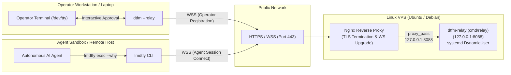

# Self-Hosting Relay Runbook: `cmd/relay`

Production runbook for self-hosting the stateless, zero-knowledge `dtfm-relay` server on a Linux VPS (targeting Ubuntu LTS / Debian with `systemd`, `nginx`, and automated TLS).

---

## 1. Overview & Architecture

`cmd/relay` (published as the `relay` release binary, which self-identifies as `dtfm-relay` and is installed to `/usr/local/bin/dtfm-relay` in this guide) is an in-memory, zero-database WebSocket pairing hub that bridges operators (`dtfm`) and sandboxed AI coding agents (`lmdtfy`) across NATs, firewalls, and cloud environments without opening inbound ports on developer machines.



### Key Security & Operational Guarantees

- **Zero-Knowledge End-to-End Encryption (E2EE)**: The relay server never sees plaintext commands, arguments, reasons, or output. Cryptographic subkeys and Authenticated Encryption (AES-256-GCM) ciphers are derived on client machines via HKDF-SHA256 from a 256-bit secret carried exclusively in the URL fragment (`#<key>`), which is never transmitted to the relay server over HTTP or WebSocket headers.
- **Zero Persistent State (Fail-Closed on Restart)**: The relay operates entirely in memory with no database (no SQLite, Postgres, or Redis), no disk storage, and no stateful configuration. If the relay process restarts, all in-memory sessions are cleared and active WebSocket connections fail closed (`dtfm --relay` exits with code `1`); operators must restart `dtfm --relay` and share the new Magic Link or Pairing Token with their agents.
- **Sandboxed Execution**: Runs under systemd with `DynamicUser=yes`, `NoNewPrivileges=yes`, `ProtectSystem=strict`, and empty Linux capabilities (`CapabilityBoundingSet=`), listening strictly on `127.0.0.1:8088`.
- **Built-in Rate Limiting & DoS Protection**: Hardened against abuse with concurrent session limits (`--max-sessions 10000`), per-IP limits (`--max-sessions-per-ip 64`), idle session sweeping (`--idle-timeout 10m`), trusted proxy CIDR inspection, and 5 MiB frame caps for untrusted agents.

---

## 2. Agent-Assisted Fast Path

If you are using an AI coding agent (e.g., Claude Code, `agy`, Cursor, Aider) on your local workstation to configure the VPS, you do not need to give the agent SSH credentials or root access to the remote server.

Instead, start `dtfm` on the VPS over a dedicated SSH-forwarded Unix socket from your laptop in a single command, then hand a 1-line instruction to your local agent.

### Step 1: Start `dtfm` on the VPS from Your Laptop

> [!NOTE]
> If `dtfm` is not yet installed on your VPS, install and verify it in one command first:
> ```bash
> ssh <vps-user>@<vps-ip> 'os="$(uname -s | tr "[:upper:]" "[:lower:]")" && arch="$(uname -m | sed -e "s/x86_64/amd64/" -e "s/aarch64/arm64/")" && tmp="$(mktemp -d)" && (cd "$tmp" && curl -fsSLO "https://github.com/iinozemtsev-lab/dtfm/releases/latest/download/dtfm-${os}-${arch}" && curl -fsSLO "https://github.com/iinozemtsev-lab/dtfm/releases/latest/download/SHA256SUMS" && grep -E "^[0-9a-f]{64}  dtfm-${os}-${arch}\$" SHA256SUMS | sha256sum -c - && mkdir -p ~/.local/bin && install -m 0755 "dtfm-${os}-${arch}" ~/.local/bin/dtfm); rc=$?; rm -rf "$tmp"; exit $rc'
> ```

Run this command in a terminal on your Linux or macOS developer laptop:

```bash
install -d -m 0700 "/tmp/dtfm-vps-$(id -u)" && \
ssh -t -o StreamLocalBindUnlink=yes \
  -L "/tmp/dtfm-vps-$(id -u)/lmdtfy.sock:/tmp/dtfm-vps-<vps-user>/lmdtfy.sock" \
  <vps-user>@<vps-ip> "~/.local/bin/dtfm --socket /tmp/dtfm-vps-<vps-user>/lmdtfy.sock"
```

*(Replace `<vps-user>` and `<vps-ip>` with your VPS login and IP address; add `-p <ssh-port>` if your VPS uses a custom SSH port).*

Why this command uses explicit paths and a dedicated socket directory:
- Non-login `ssh` command invocations do not load `~/.profile`, so `~/.local/bin/dtfm` is invoked by explicit path rather than assuming `~/.local/bin` is in `PATH`.
- Forwarding a dedicated `0700` socket directory (`/tmp/dtfm-vps-$(id -u)/lmdtfy.sock` locally and `/tmp/dtfm-vps-<vps-user>/lmdtfy.sock` on the VPS) avoids clobbering any local `dtfm` listener on your workstation and works even for `root` or minimal VPS accounts without `systemd-logind` (`/run/user/<uid>`).

### Step 2: The 1-Line Agent Prompt

Paste this into your local agent's chat (replacing `relay.example.com` with your target domain):

```text
Read https://raw.githubusercontent.com/iinozemtsev-lab/dtfm/main/docs/lmdtfy_guide.md (install lmdtfy locally if needed) and https://raw.githubusercontent.com/iinozemtsev-lab/dtfm/main/docs/host_relay.md, then provision relay.example.com on the VPS using `lmdtfy ping --socket "/tmp/dtfm-vps-$(id -u)/lmdtfy.sock"` and `lmdtfy exec --socket "/tmp/dtfm-vps-$(id -u)/lmdtfy.sock" --why "<reason>" -- <cmd>`: execute Sections 3–6 (and Section 7 if auto-updates are desired), wrapping any compound/pipe/heredoc shell commands in `bash -c '...'` since dtfm uses direct execvp, and finish by verifying `https://relay.example.com/healthz` (Section 8, Test 1 — do not launch the interactive `dtfm --relay` listener in Test 2).
```

> [!IMPORTANT]
> `dtfm` executes approved commands directly via `execvp` without spawning an implicit shell (unless edited inline with `[e]`), and binds child `stdin` to `/dev/null`. When dispatching multi-step snippets containing `&&`, pipes (`|`), redirections, or `<<'EOF'` heredocs via `lmdtfy exec`, invoke `bash -c '...'` explicitly.

### Step 3: Human-in-the-Loop Review

As your agent dispatches commands, each request appears interactively on your laptop terminal where the VPS `dtfm` instance is running:

```text
────────────────────────────────────────────────────────────
🔔 LMDTFY Command Execution Request:
   Reason:  Install Nginx and Certbot for relay reverse proxy
   Command: bash -c 'sudo apt-get update && sudo env DEBIAN_FRONTEND=noninteractive apt-get install -y nginx certbot'
────────────────────────────────────────────────────────────
Approve execution? [y] Run  [e] Edit  [n] Reject:
```

When `sudo` prompts for a password on the VPS, `dtfm` hands foreground `/dev/tty` control directly to `sudo` so you enter your password securely on your terminal. The agent process never sees your password or SSH keys.

---

## 3. Prerequisites & Expected DNS

Before configuring the relay, ensure your domain and firewall are ready.

### Domain Name System (DNS) Records

Configure the following records with your DNS provider (e.g., Cloudflare, Route53, Namecheap):

| Record Type | Host | Target / Value | Description |
|---|---|---|---|
| `A` | `relay` (or `relay.example.com`) | `<vps-ip>` (e.g. `203.0.113.10`) | VPS public IPv4 address |
| `AAAA` *(optional)* | `relay` (or `relay.example.com`) | `<vps-ipv6>` (e.g. `2001:db8::10`) | VPS public IPv6 address |

*(Replace `relay.example.com` with your actual subdomain and `<vps-ip>` with your VPS IP address).*

### Firewall & Open Ports

The VPS requires only two inbound public web ports alongside administrative SSH:

- `80/tcp` (HTTP): Used for Let's Encrypt ACME HTTP-01 domain challenge and HTTP-to-HTTPS redirect.
- `443/tcp` (HTTPS / WSS): Primary TLS-terminated WebSocket relay endpoint and health check.
- `22/tcp` (or your custom SSH port): For administrative SSH access.

Port `8088` (the `dtfm-relay` backend port) must **never** be opened in the firewall; it binds strictly to the loopback interface (`127.0.0.1:8088`).

> [!WARNING]
> If your VPS uses a custom SSH port instead of `22/tcp`, replace `sudo ufw allow OpenSSH` below with `sudo ufw allow <ssh-port>/tcp` **before** enabling UFW so you do not lock yourself out of SSH.

**Example UFW (Uncomplicated Firewall) Setup:**
```bash
sudo ufw default deny incoming
sudo ufw default allow outgoing
sudo ufw allow OpenSSH
sudo ufw allow 80/tcp comment 'ACME HTTP-01 challenge and HTTPS redirect'
sudo ufw allow 443/tcp comment 'dtfm relay HTTPS and WebSocket'
sudo ufw --force enable
```

*(`--force` skips UFW's interactive `[y/n]` prompt on `stdin`, which is required when running non-interactively or via `dtfm` where child `stdin` is bound to `/dev/null`).*

### Cloudflare Proxy (Orange Cloud) vs. DNS-Only (Grey Cloud)

- **DNS-Only (Grey Cloud — Recommended for simplicity)**: Direct TCP connection from clients to your VPS. Nginx handles Let's Encrypt certificate issuance directly via HTTP-01 challenges, `$remote_addr` already reflects each client's true public IP, and clients connect over direct low-latency WebSockets.
- **Cloudflare Proxied (Orange Cloud)**:
  - **WebSocket Support**: WebSockets are supported out of the box on port 443 across all Cloudflare tiers without extra configuration.
  - **100-Second Idle Timeout**: Cloudflare automatically terminates idle WebSocket connections if no traffic is exchanged for 100 seconds. `dtfm-relay` and `dtfm` send automated WebSocket ping/pong frames every 81 seconds (`pingPeriod = 81s`, `pongWait = 90s`), and `lmdtfy` sends pings every 30 seconds (`pingPeriod = 30s`), keeping connections alive within Cloudflare's window.
  - **TLS Modes**: Set Cloudflare SSL/TLS encryption mode to **Full (Strict)**. You can either issue a Let's Encrypt certificate via Certbot (HTTP-01 passes through the proxy) or install a free 15-year Cloudflare Origin CA certificate on Nginx.
  - **Real Client IPs (Required for Per-IP Rate Limiting)**: When proxied through Cloudflare, TCP connections to Nginx originate from Cloudflare's edge IPs. Without unwrapping `CF-Connecting-IP`, Nginx forwards Cloudflare's edge IP in `$remote_addr`, causing `dtfm-relay` to pool all users routed through the same Cloudflare PoP under `--max-sessions-per-ip 64` (returning HTTP `503 Service Unavailable`).
    After installing Nginx (Section 6), configure `ngx_http_realip_module` to trust Cloudflare's published IPv4/IPv6 ranges and restore the true client IP from `CF-Connecting-IP`:
    ```bash
    CF_V4="$(curl -fsSL https://www.cloudflare.com/ips-v4)" && \
    CF_V6="$(curl -fsSL https://www.cloudflare.com/ips-v6)" && \
    {
      echo "# Cloudflare Edge Proxy IPs (restore true client IP)"
      printf '%s\n' "$CF_V4" | grep -E '^[0-9./]+$' | sed 's|^|set_real_ip_from |; s|$|;|'
      printf '%s\n' "$CF_V6" | grep -E '^[0-9a-fA-F:/]+$' | sed 's|^|set_real_ip_from |; s|$|;|'
      echo "real_ip_header CF-Connecting-IP;"
    } | sudo tee /etc/nginx/conf.d/cloudflare-realip.conf >/dev/null && \
    sudo nginx -t && sudo systemctl reload nginx
    ```
    *(Refresh `/etc/nginx/conf.d/cloudflare-realip.conf` periodically if Cloudflare updates `https://www.cloudflare.com/ips/`. Alternatively, append Cloudflare's published CIDRs to `--trusted-proxies` in `dtfm-relay.service` so `dtfm-relay` strips the Cloudflare proxy hop directly when parsing `X-Forwarded-For` right-to-left).*

---

## 4. Install `relay` Binary

The `cmd/relay` server is distributed as a hermetic static executable (`CGO_ENABLED=0`) compiled for Linux (`amd64` and `arm64`) and published on [GitHub Releases](https://github.com/iinozemtsev-lab/dtfm/releases) as `relay-<os>-<arch>` (and as `relay` inside release `.tar.gz` archives).

In this runbook, we install the `relay` binary to `/usr/local/bin/dtfm-relay` to avoid generic binary name collisions in `/usr/local/bin` and match the `dtfm-relay` version banner and systemd unit name.

### 1-Line Verified Installation

Run this snippet on the VPS to detect architecture, download the latest `relay` binary alongside `SHA256SUMS`, cryptographically verify the exact asset checksum, and install it to `/usr/local/bin/dtfm-relay`:

```bash
(
  OS="$(uname -s | tr '[:upper:]' '[:lower:]')" && \
  ARCH="$(uname -m | sed -e 's/x86_64/amd64/' -e 's/aarch64/arm64/')" && \
  TMP_DIR="$(mktemp -d)" && \
  trap 'rm -rf "$TMP_DIR"' EXIT && \
  cd "$TMP_DIR" && \
  curl -fsSLO "https://github.com/iinozemtsev-lab/dtfm/releases/latest/download/relay-${OS}-${ARCH}" && \
  curl -fsSLO "https://github.com/iinozemtsev-lab/dtfm/releases/latest/download/SHA256SUMS" && \
  grep -E "^[0-9a-f]{64}  relay-${OS}-${ARCH}\$" SHA256SUMS | sha256sum -c - && \
  sudo install -m 0755 "relay-${OS}-${ARCH}" /usr/local/bin/dtfm-relay
)
```

### Verify Binary Installation

Confirm the binary is installed, executable, and prints its release version (`dtfm-relay v<X.Y.Z>`):

```bash
/usr/local/bin/dtfm-relay --version
```

---

## 5. Sandboxed `systemd` Service

Create a hardened `systemd` unit that isolates the relay process with zero unnecessary privileges, unprivileged dynamic user execution, and restricted kernel/filesystem access.

### Create `/etc/systemd/system/dtfm-relay.service`

Write the unit file using `sudo tee`:

```bash
sudo tee /etc/systemd/system/dtfm-relay.service >/dev/null <<'EOF'
[Unit]
Description=dtfm relay server (stateless in-memory WebSocket pairing hub)
Documentation=https://github.com/iinozemtsev-lab/dtfm
After=network.target

[Service]
Type=simple
ExecStart=/usr/local/bin/dtfm-relay --listen 127.0.0.1:8088 --idle-timeout 10m --max-sessions 10000 --max-sessions-per-ip 64 --trusted-proxies 127.0.0.0/8,::1/128
Restart=always
RestartSec=5s

# Process Sandboxing & Hardening
DynamicUser=yes
NoNewPrivileges=yes
ProtectSystem=strict
ProtectHome=yes
PrivateTmp=yes
PrivateDevices=yes
ProtectKernelTunables=yes
ProtectKernelModules=yes
ProtectControlGroups=yes
RestrictAddressFamilies=AF_INET AF_INET6 AF_UNIX
RestrictNamespaces=yes
RestrictRealtime=yes
RestrictSUIDSGID=yes
MemoryDenyWriteExecute=yes
LockPersonality=yes
CapabilityBoundingSet=
AmbientCapabilities=
LimitNOFILE=65536

[Install]
WantedBy=multi-user.target
EOF
```

### Key Service Options Explained

| Parameter | Value | Security & Operational Purpose |
|---|---|---|
| `--listen` | `127.0.0.1:8088` | Binds strictly to local IPv4 loopback; never accessible directly from the public internet. |
| `--idle-timeout` | `10m` | Evicts abandoned sessions after 10 minutes without traffic or pongs. **Must remain `> 81s`** (recommended `>= 2m`) since `dtfm-relay` and `dtfm` exchange keepalive pings every `81s` (`lmdtfy` every `30s`). |
| `--max-sessions` | `10000` | Caps total concurrent in-memory sessions (returns HTTP `503` / WS close `4029` when full). |
| `--max-sessions-per-ip` | `64` | Caps concurrent operator sessions per client IP (returns HTTP `503` / WS close `4029` when exceeded). |
| `--trusted-proxies` | `127.0.0.0/8,::1/128` | Trusts forwarded client IP headers (`X-Forwarded-For` right-to-left, fallback `X-Real-IP`) only from local Nginx. See Section 3 if using Cloudflare Orange Cloud. |
| `DynamicUser=yes` | `yes` | Allocates a transient, unprivileged UID/GID dynamically at startup; no persistent user account needed. |
| `ProtectSystem=strict` | `strict` | Mounts `/usr`, `/boot`, `/etc`, and system directories strictly read-only. |
| `CapabilityBoundingSet=` | *(empty)* | Drops all POSIX capabilities (no `CAP_NET_BIND_SERVICE`, no `CAP_SYS_ADMIN`, etc.). |
| `LimitNOFILE` | `65536` | Increases file descriptor limit to handle thousands of concurrent WebSocket client connections. |

### Enable and Start the Service

```bash
sudo systemctl daemon-reload
sudo systemctl enable --now dtfm-relay
sudo systemctl status --no-pager dtfm-relay
```

### Local Health Verification

Verify that the relay is listening and responding over local loopback:

```bash
curl -fsS http://127.0.0.1:8088/healthz
```

Expected output:
```text
dtfm-relay ok
```

---

## 6. Nginx Reverse Proxy & TLS Configuration

Nginx handles TLS termination, certificate renewal reloads via Let's Encrypt (`certbot --webroot`), and upgrades HTTP connections to long-lived WebSockets (`ws` -> `wss`).

Follow these steps in order so Nginx passes ACME HTTP-01 domain validation on port 80 before referencing the TLS certificate files on port 443.

### Step 1: Install Nginx and Certbot

```bash
sudo apt-get update
sudo env DEBIAN_FRONTEND=noninteractive apt-get install -y nginx certbot
```

### Step 2: Bootstrap HTTP (Port 80) & Obtain TLS Certificate

*(If you are using a pre-generated Cloudflare Origin CA certificate instead of Let's Encrypt, place your certificate and private key on disk and skip directly to Step 3).*

1. Write a minimal HTTP port-80 bootstrap configuration to serve the ACME challenge directory (replace `relay.example.com` with your actual domain):
   ```bash
   sudo tee /etc/nginx/sites-available/dtfm-relay >/dev/null <<'EOF'
   server {
       listen 80;
       listen [::]:80;
       server_name relay.example.com;

       location /.well-known/acme-challenge/ {
           root /var/www/html;
       }

       location / {
           return 301 https://$host$request_uri;
       }
   }
   EOF
   ```

2. Create the webroot directory, enable the site, and reload Nginx:
   ```bash
   sudo mkdir -p /var/www/html
   sudo ln -sf /etc/nginx/sites-available/dtfm-relay /etc/nginx/sites-enabled/dtfm-relay
   sudo rm -f /etc/nginx/sites-enabled/default
   sudo systemctl enable --now nginx
   sudo nginx -t && sudo systemctl reload nginx
   ```
   *(Note: Remove `/etc/nginx/sites-enabled/default` only on a dedicated VPS where the default catch-all site is unused).*

3. Obtain the initial TLS certificate via Certbot with `--deploy-hook "systemctl reload nginx"` so future automated renewals reload Nginx's in-memory certificate cleanly:
   ```bash
   sudo certbot certonly --webroot -w /var/www/html -d relay.example.com \
     --deploy-hook "systemctl reload nginx" \
     --non-interactive --agree-tos --register-unsafely-without-email
   ```
   *(Replace `--register-unsafely-without-email` with `-m your-email@example.com` to receive Let's Encrypt expiration alerts. Certbot persists `--deploy-hook` as `renew_hook` in `/etc/letsencrypt/renewal/relay.example.com.conf`).*

### Step 3: Activate Production HTTPS & WebSocket Reverse Proxy

Now that `/etc/letsencrypt/live/relay.example.com/fullchain.pem` and `privkey.pem` exist on disk, write the complete HTTP + HTTPS WebSocket configuration (replace `relay.example.com` with your actual domain):

```bash
sudo tee /etc/nginx/sites-available/dtfm-relay >/dev/null <<'EOF'
# Map Connection header for WebSocket upgrades
map $http_upgrade $connection_upgrade {
    default upgrade;
    ''      close;
}

server {
    listen 80;
    listen [::]:80;
    server_name relay.example.com;

    # Let's Encrypt ACME HTTP-01 challenge directory
    location /.well-known/acme-challenge/ {
        root /var/www/html;
    }

    # Redirect all other HTTP traffic to HTTPS
    location / {
        return 301 https://$host$request_uri;
    }
}

server {
    # Note: On Nginx 1.25.1+ (e.g. Debian 13 or nginx.org mainline), replace
    # "listen ... ssl http2;" with "listen 443 ssl;" / "listen [::]:443 ssl;"
    # and add "http2 on;" on its own line below.
    listen 443 ssl http2;
    listen [::]:443 ssl http2;
    server_name relay.example.com;

    # TLS Certificates (managed by Certbot)
    ssl_certificate /etc/letsencrypt/live/relay.example.com/fullchain.pem;
    ssl_certificate_key /etc/letsencrypt/live/relay.example.com/privkey.pem;

    # Modern TLS Security Parameters
    ssl_protocols TLSv1.2 TLSv1.3;
    ssl_ciphers HIGH:!aNULL:!MD5:!3DES;
    ssl_prefer_server_ciphers on;
    ssl_session_cache shared:SSL:10m;
    ssl_session_timeout 1d;
    ssl_session_tickets off;

    # Security Headers
    add_header X-Content-Type-Options "nosniff" always;
    add_header X-Frame-Options "DENY" always;

    # Reverse Proxy to dtfm-relay
    location / {
        proxy_pass http://127.0.0.1:8088;
        proxy_http_version 1.1;

        # Avoid duplicating X-Content-Type-Options: nosniff already set by dtfm-relay
        proxy_hide_header X-Content-Type-Options;

        # WebSocket Upgrade Headers
        proxy_set_header Upgrade $http_upgrade;
        proxy_set_header Connection $connection_upgrade;

        # Forwarded Client Identity Headers
        proxy_set_header Host $host;
        proxy_set_header X-Real-IP $remote_addr;
        proxy_set_header X-Forwarded-For $proxy_add_x_forwarded_for;
        proxy_set_header X-Forwarded-Proto $scheme;

        # Unbuffered WebSocket Frame Forwarding & Long-Lived Timeouts
        proxy_buffering off;
        proxy_read_timeout 3600s;
        proxy_send_timeout 3600s;
    }
}
EOF
```

Test the Nginx syntax and reload:

```bash
sudo nginx -t && sudo systemctl reload nginx
```

### Step 4: Verify Certbot Automated Renewal

Certbot installs a systemd timer (`certbot.timer`) that checks twice daily for certificates approaching expiration and runs the persisted `--deploy-hook` (`systemctl reload nginx`) whenever a certificate is renewed. Verify renewal with a dry run:

```bash
sudo certbot renew --dry-run
```

Expected output:
```text
Congratulations, all simulated renewals succeeded:
  /etc/letsencrypt/live/relay.example.com/fullchain.pem (success)
```

---

## 7. Optional Automated Update Timer

To keep `dtfm-relay` updated with verified upstream releases, configure a daily systemd update timer.

> [!NOTE]
> When a new upstream release is installed, `systemctl restart dtfm-relay` terminates any active in-memory relay sessions (`dtfm --relay` fails closed with exit code `1` and must be restarted with a fresh Session ID / Magic Link). When `dtfm-relay` is already on the latest version, the script exits `0` without restarting the service. Schedule `OnCalendar=` during an off-peak window.

### Create Update Script: `/usr/local/bin/dtfm-relay-update.sh`

```bash
sudo tee /usr/local/bin/dtfm-relay-update.sh >/dev/null <<'EOF'
#!/usr/bin/env bash
set -euo pipefail

CURRENT_VER=""
if [ -x /usr/local/bin/dtfm-relay ]; then
    CURRENT_VER="$(/usr/local/bin/dtfm-relay --version 2>/dev/null | awk '{print $2}' || true)"
fi

# Resolve latest release tag via HTML redirect (avoids GitHub REST API rate limits and large JSON pipes)
EFFECTIVE_URL="$(curl -fsSLI --connect-timeout 10 --max-time 30 -o /dev/null -w '%{url_effective}' https://github.com/iinozemtsev-lab/dtfm/releases/latest)"
EFFECTIVE_URL="${EFFECTIVE_URL%/}"
case "$EFFECTIVE_URL" in
    */releases/tag/*)
        LATEST_TAG="${EFFECTIVE_URL##*/releases/tag/}"
        ;;
    *)
        echo "Error: Unexpected redirect URL from GitHub releases/latest: $EFFECTIVE_URL" >&2
        exit 1
        ;;
esac

SEMVER_RE='^v(0|[1-9][0-9]*)\.(0|[1-9][0-9]*)\.(0|[1-9][0-9]*)(-[0-9A-Za-z-]+(\.[0-9A-Za-z-]+)*)?(\+[0-9A-Za-z-]+(\.[0-9A-Za-z-]+)*)?$'
if [[ "$LATEST_TAG" == *$'\n'* || "$LATEST_TAG" == *$'\r'* || ! "$LATEST_TAG" =~ $SEMVER_RE ]]; then
    echo "Error: Invalid SemVer tag '$LATEST_TAG' resolved from GitHub." >&2
    exit 1
fi

if [ "$CURRENT_VER" = "$LATEST_TAG" ]; then
    echo "dtfm-relay is already up to date ($CURRENT_VER)."
    exit 0
fi

OS="$(uname -s | tr '[:upper:]' '[:lower:]')"
ARCH="$(uname -m | sed -e 's/x86_64/amd64/' -e 's/aarch64/arm64/')"
case "${OS}-${ARCH}" in
    linux-amd64|linux-arm64) ;;
    *)
        echo "Error: Unsupported platform '${OS}-${ARCH}'." >&2
        exit 1
        ;;
esac

echo "Updating dtfm-relay from ${CURRENT_VER:-none} to $LATEST_TAG..."
TMP_DIR="$(mktemp -d)"
trap 'rm -rf "$TMP_DIR"' EXIT

cd "$TMP_DIR"
curl -fsSL --connect-timeout 10 --max-time 120 -O "https://github.com/iinozemtsev-lab/dtfm/releases/download/${LATEST_TAG}/relay-${OS}-${ARCH}"
curl -fsSL --connect-timeout 10 --max-time 30 -O "https://github.com/iinozemtsev-lab/dtfm/releases/download/${LATEST_TAG}/SHA256SUMS"

grep -E "^[0-9a-f]{64}  relay-${OS}-${ARCH}\$" SHA256SUMS | sha256sum -c -
chmod 0755 "relay-${OS}-${ARCH}"
"./relay-${OS}-${ARCH}" --version >/dev/null

install -m 0755 "relay-${OS}-${ARCH}" /usr/local/bin/dtfm-relay
systemctl restart dtfm-relay
echo "Successfully updated dtfm-relay to $(/usr/local/bin/dtfm-relay --version)."
EOF
sudo chmod 0755 /usr/local/bin/dtfm-relay-update.sh
```

### Create Systemd Update Service & Timer

Write the service and timer unit files:

```bash
sudo tee /etc/systemd/system/dtfm-relay-update.service >/dev/null <<'EOF'
[Unit]
Description=dtfm-relay release auto-update
Documentation=https://github.com/iinozemtsev-lab/dtfm
After=network-online.target
Wants=network-online.target

[Service]
Type=oneshot
TimeoutStartSec=5m
ExecStart=/usr/local/bin/dtfm-relay-update.sh
EOF

sudo tee /etc/systemd/system/dtfm-relay-update.timer >/dev/null <<'EOF'
[Unit]
Description=Daily update check for dtfm-relay
Documentation=https://github.com/iinozemtsev-lab/dtfm

[Timer]
OnCalendar=*-*-* 04:00:00 UTC
RandomizedDelaySec=30m
Persistent=true

[Install]
WantedBy=timers.target
EOF
```

### Enable Update Timer

```bash
sudo systemctl daemon-reload
sudo systemctl enable --now dtfm-relay-update.timer
sudo systemctl list-timers --no-pager dtfm-relay-update.timer
```

---

## 8. End-to-End Verification

Follow these verification tests to confirm that the public relay, TLS, WebSocket routing, and client encryption are operating correctly.

### Test 1: Public HTTP Health Check

From your laptop (or any external computer), query the public health endpoint:

```bash
curl -fsS https://relay.example.com/healthz
```

Expected output:
```text
dtfm-relay ok
```

*(Also confirm that `curl -fsSI https://relay.example.com/` returns HTTP `200`).*

---

### Test 2: Start Operator Relay Listener (`dtfm`)

On your operator workstation / laptop, start `dtfm` in relay mode targeting your self-hosted endpoint:

```bash
dtfm --relay --relay-url wss://relay.example.com/ws
```

Expected terminal display (by default, `dtfm` generates a random 32-character hex Session ID and a 64-character hex 256-bit E2EE secret key):

```text
🟢 dtfm relay session started.
Relay: wss://relay.example.com/ws
Session ID: 4f8a2c91e70b3d64a195c8e2f047b31d
User: ivan @ workstation

Agent Magic Link:
  https://relay.example.com/c/4f8a2c91e70b3d64a195c8e2f047b31d#8f9c2d1e4a7b0635c91e2f4d8a3b7c60192837465564738291a0b1c2d3e4f506

Pairing Token:
  4f8a2c91e70b3d64a195c8e2f047b31d#8f9c2d1e4a7b0635c91e2f4d8a3b7c60192837465564738291a0b1c2d3e4f506

Waiting for agent requests... (Press Ctrl+C to exit)
```

> [!TIP]
> When `--relay-url` is provided, `dtfm` automatically derives the Magic Link base URL (`https://relay.example.com`). Pass `--hub-url <url>` **alongside** `--relay-url` only if you host a separate web landing hub on another domain, or pass `--session <id>` to specify a custom `[a-zA-Z0-9_-]{1,64}` session ID.

---

### Test 3: Agent Ping Verification (`lmdtfy ping`)

From a remote server, Docker container, or CI runner, run `lmdtfy ping` using the full Agent Magic Link printed by your `dtfm` session in Test 2:

```bash
lmdtfy ping --relay "https://relay.example.com/c/4f8a2c91e70b3d64a195c8e2f047b31d#8f9c2d1e4a7b0635c91e2f4d8a3b7c60192837465564738291a0b1c2d3e4f506"
```

Expected output:
```text
🟢 LMDTFY session is ACTIVE (User: ivan @ workstation, Time: 2026-11-12T22:00:00Z)
```

Exit code: `0`.

> [!TIP]
> On the agent host, you can export `LMDTFY_RELAY="https://relay.example.com/c/<session-id>#<key>"` so `lmdtfy ping` and `lmdtfy exec` connect automatically without repeating `--relay`. If you pass the compact **Pairing Token** (`<session-id>#<key>`) instead of the full Magic Link URL, also export `LMDTFY_RELAY_URL="wss://relay.example.com/ws"` (or pass `--relay-url`) so `lmdtfy` targets your self-hosted endpoint. Note that `LMDTFY_RELAY` and `LMDTFY_RELAY_URL` are read by `lmdtfy` only, not `dtfm`.

---

### Test 4: End-to-End Command Execution (`lmdtfy exec`)

From the remote agent environment, dispatch a test command (substituting the Magic Link printed in Test 2):

```bash
lmdtfy exec --relay "https://relay.example.com/c/4f8a2c91e70b3d64a195c8e2f047b31d#8f9c2d1e4a7b0635c91e2f4d8a3b7c60192837465564738291a0b1c2d3e4f506" --why "Self-test relay execution" -- uname -a
```

On your operator terminal, `dtfm` immediately prompts for review:

```text
────────────────────────────────────────────────────────────
🔔 LMDTFY Command Execution Request:
   Reason:  Self-test relay execution
   Command: uname -a
────────────────────────────────────────────────────────────
Approve execution? [y] Run  [e] Edit  [n] Reject:
```

Press `y` + `Enter`.

The command executes on your workstation (mirroring live output on your operator terminal), and once it finishes, captured `stdout` and `stderr` (buffered up to `1 MiB` per stream) are returned encrypted to the remote agent across the self-hosted relay:

```text
Linux workstation 6.8.0 #1 SMP PREEMPT_DYNAMIC x86_64 GNU/Linux
```

Exit code: `0`.

---

## 9. Troubleshooting & Operational Reference

### Inspect Relay Logs

```bash
sudo journalctl -u dtfm-relay -f
```

To enable verbose protocol logging in `dtfm-relay`, add `--verbose` to `ExecStart` in `/etc/systemd/system/dtfm-relay.service`, then run `sudo systemctl daemon-reload && sudo systemctl restart dtfm-relay`.

### Inspect Nginx Access and Error Logs

```bash
sudo tail -f /var/log/nginx/error.log
sudo tail -f /var/log/nginx/access.log
```

### Common Issues & Resolutions

| Symptom | Cause | Resolution |
|---|---|---|
| `502 Bad Gateway` from Nginx | `dtfm-relay` service is stopped or failed to bind on `127.0.0.1:8088`. | Run `sudo systemctl status --no-pager dtfm-relay` and verify `curl -fsS http://127.0.0.1:8088/healthz`. |
| `503 Service Unavailable` (or WS close `4029`) | `--max-sessions` or `--max-sessions-per-ip` limit reached, or Cloudflare edge IPs are pooling all clients into one IP bucket. | Check `journalctl -u dtfm-relay`. If using Cloudflare Orange Cloud, configure `set_real_ip_from` + `real_ip_header CF-Connecting-IP;` in Nginx (or add Cloudflare CIDRs to `--trusted-proxies`; see Section 3). |
| `403 Forbidden` (or WS close `4003`) | Secret key / auth verifier mismatch, `--session` ID collision with another active operator key, or `Origin` vs. `Host` header mismatch. | Ensure the agent uses the exact Magic Link from the active `dtfm` session, and verify `proxy_set_header Host $host;` is present in Nginx. |
| `409 Conflict` (or WS close `4009`) | Another `lmdtfy` command is already active on the same session. | Wait for the in-flight `lmdtfy` request to finish; each relay session handles one active agent connection at a time. |
| WebSocket drops after ~60–100 seconds | Nginx `proxy_read_timeout` expired, or `dtfm-relay` `--idle-timeout` was set `<= 81s`. | Ensure `proxy_read_timeout 3600s;` and `proxy_buffering off;` in Nginx, and keep `--idle-timeout` `> 81s` (default `10m`). |
| `Certbot failed to authenticate` | Port `80/tcp` blocked, or `A` / `AAAA` DNS record not pointing to this VPS. | Confirm `dig +short A relay.example.com` (and `AAAA`, if set) matches your VPS IPs and `sudo ufw status` allows `80/tcp`. |
| `inactive session (exit code 2)` / HTTP `404` | Operator closed `dtfm`, `dtfm-relay` restarted (clearing in-memory state), or session timed out. | Start `dtfm --relay --relay-url wss://relay.example.com/ws` on the operator workstation and use the fresh Magic Link. |
