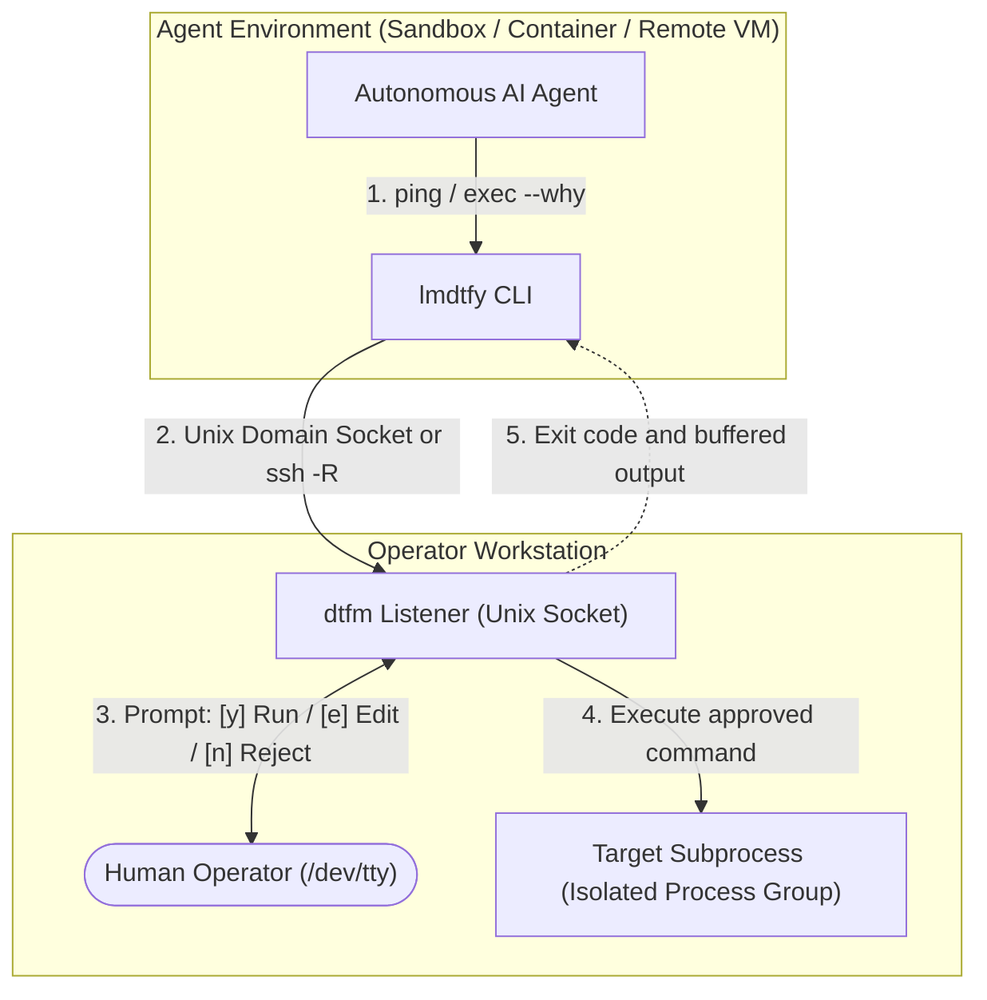

# Agent Onboarding Manual: `lmdtfy`

Canonical operational guide for autonomous AI coding agents, sandboxed runners, and automated tools using `lmdtfy` as a reverse Human-in-the-Loop (HITL) execution gateway.

---

## 1. Overview & Security Model

`lmdtfy` (*Let Me Do That For You*) is a lightweight, hermetic static binary that acts as a client to `dtfm` (*Do That For Me*). It provides a reverse HITL execution bridge for autonomous coding agents running in:

- Sandboxed containers (Docker, Podman, LXC)
- Virtual machines and cloud dev environments (GitHub Codespaces, Gitpod, AWS EC2, GCP Compute Engine)
- Remote hosts accessed over SSH
- Local agent sub-processes with restricted privileges



### Why Agents Use `lmdtfy`

Rather than granting unbounded privileges (such as passwordless `sudo`, production credentials, or unconstrained host shell access) to an autonomous agent, the agent runs within an unprivileged sandbox and delegates sensitive operations through `lmdtfy`.

Key security guarantees:
- **Mandatory Intent**: Every execution request requires a human-readable explanation (`--why "<reason>"`).
- **Interactive Human Oversight**: The operator reviews the exact command and rationale on `/dev/tty` before execution begins.
- **Fail-Closed Security**: Client disconnects, terminal EOFs, or forbidden payloads (such as custom environment variables) immediately reject execution (exit code `126`).
- **Process & Resource Isolation**: Grandchild processes run in dedicated process groups; `dtfm` displays live output on the operator workstation while buffering up to 1 MB per stream (`stdout`/`stderr`) and returning captured output to `lmdtfy` upon command completion; wire messages are capped at 4 MB.

---

## 2. Installation

`lmdtfy` is distributed as a hermetic, dependency-free static binary (`CGO_ENABLED=0`) compiled for Linux and macOS across AMD64 and ARM64 architectures.

### 1-Line Installation Snippet

To install the latest matching static binary into `~/.local/bin/lmdtfy` atomically via temporary staging:

```bash
mkdir -p ~/.local/bin && tmp="$(mktemp)" && curl -fsSL "https://github.com/iinozemtsev-lab/dtfm/releases/latest/download/lmdtfy-$(uname -s | tr '[:upper:]' '[:lower:]')-$(uname -m | sed -e 's/x86_64/amd64/' -e 's/aarch64/arm64/')" -o "$tmp" && install -m 0755 "$tmp" ~/.local/bin/lmdtfy && rm -f "$tmp"
```

*(Ensure `~/.local/bin` is in your `$PATH`.)*

### System-Wide Installation (`/usr/local/bin`)

If installing system-wide into `/usr/local/bin`:

```bash
tmp="$(mktemp)" && curl -fsSL "https://github.com/iinozemtsev-lab/dtfm/releases/latest/download/lmdtfy-$(uname -s | tr '[:upper:]' '[:lower:]')-$(uname -m | sed -e 's/x86_64/amd64/' -e 's/aarch64/arm64/')" -o "$tmp" && sudo install -m 0755 "$tmp" /usr/local/bin/lmdtfy && rm -f "$tmp"
```

### Standalone Binary Targets

Static binaries can be fetched directly from `https://github.com/iinozemtsev-lab/dtfm/releases/latest/download/`:

| Platform | Architecture | Asset Name |
|---|---|---|
| Linux | x86_64 (amd64) | `lmdtfy-linux-amd64` |
| Linux | ARM64 (aarch64) | `lmdtfy-linux-arm64` |
| macOS | Apple Silicon (arm64) | `lmdtfy-darwin-arm64` |
| macOS | Intel (amd64) | `lmdtfy-darwin-amd64` |

Reproducible tarball archives containing `dtfm`, `lmdtfy`, and `relay` alongside `README.md`, `LICENSE`, and `CHANGELOG.md` are also published as `dtfm_<version>_<os>_<arch>.tar.gz` with cryptographic checksums in `SHA256SUMS`.

---

## 3. Gateway Verification: `lmdtfy ping`

Before attempting to dispatch commands, agents should verify whether an active human operator listening session is available:

```bash
lmdtfy ping [--socket <path>] [--relay <token-or-url>] [--relay-url <url>]
```

### Ping Exit Codes

| Exit Code | Session State | Output Example | Agent Action |
|:---:|---|---|---|
| `0` | **Active** | `🟢 LMDTFY session is ACTIVE (User: ivan @ workstation, Time: 2026-11-11T12:00:00Z)` | Proceed with workflow. Gateway is ready. |
| `2` | **Inactive** | `🔴 LMDTFY session is inactive (cannot connect to /run/user/1000/lmdtfy.sock)` | Gateway unavailable. Do not attempt `exec`. Ask user to start `dtfm`. |
| `1` | **Error** | `Error validating socket directory for /bad/path: ...` | Configuration or validation error. Inspect socket path or permissions. |

### Fast Verification in Agent Scripts

Discard stdout while preserving diagnostic stderr to properly surface validation/socket errors (`1` vs. `2`):

```bash
ping_rc=0
lmdtfy ping >/dev/null || ping_rc=$?
if [ "$ping_rc" -ne 0 ]; then
  echo "Error: LMDTFY gateway ping failed with exit code $ping_rc." >&2
  exit "$ping_rc"
fi
```

---

## 4. Usage Instructions: `lmdtfy exec`

### Command Syntax

```bash
lmdtfy exec --why "<reason>" [options] -- <command> [args...]
```

### Options

- `--why "<reason>"` (**Required**): A plain-English explanation of why the command is needed, what effect it will have, and why agent execution alone is insufficient. Requests with missing or empty `--why` are rejected immediately.
- `--relay <token-or-url>`: Session pairing token (`<session>#<key>`) or Agent Magic Link URL (e.g. `https://<hub-domain>/c/<session>#<key>`) to connect to an operator workstation over the zero-database WebSocket relay with authenticated AES-256-GCM End-to-End Encryption. (Can also be supplied via `LMDTFY_RELAY` environment variable).
- `--relay-url <url>`: Override the WebSocket relay endpoint URL (e.g. `wss://<relay-host>/ws`; inferred automatically when `--relay` is a full Magic Link or `wss://` URL). (Can also be supplied via `LMDTFY_RELAY_URL` environment variable).
- `--timeout <sec>`: Bounding timeout in seconds bounding operator review and command execution *separately* (default: `300` seconds / 5 minutes; maximum `86400`; worst-case wall-clock wait `~2x` timeout).
- `--cwd <path>`: Working directory on the target execution host (defaults to `dtfm`'s working directory).
- `--socket <path>`: Custom Unix domain socket path (defaults to `/run/user/<uid>/lmdtfy.sock` on Linux, `~/.lmdtfy.sock` on macOS). (Can also be supplied via `LMDTFY_SOCKET` environment variable).

### Environment Variables

| Variable | Flag Equivalent | Description |
|---|---|---|
| `LMDTFY_SOCKET` | `--socket <path>` | Path to the Unix domain socket for local/SSH forwarding mode. |
| `LMDTFY_RELAY` | `--relay <token-or-url>` | Session pairing token (`<session>#<key>`) or Agent Magic Link URL for E2EE relay mode. |
| `LMDTFY_RELAY_URL` | `--relay-url <url>` | Override endpoint for the WebSocket relay server (e.g. `wss://<relay-host>/ws`). |

### Invocation Examples

1. **Direct Binary Execution**:
   ```bash
   lmdtfy exec --why "Install libsqlite3 development headers" sudo apt-get install -y libsqlite3-dev
   ```

2. **Multi-Argument Command Execution**:
   ```bash
   lmdtfy exec --why "Verify repository status on operator workstation" git status --short
   ```

3. **Compound Shell Commands (Pipes, Chains, Redirections)**:
   Because commands are executed directly via `execvp` without an implicit subshell, compound expressions using `&&`, `||`, or `|` should be invoked explicitly via `bash -c` or `sh -c`:
   ```bash
   lmdtfy exec --why "Update package index and install dependencies" bash -c "sudo apt-get update && sudo apt-get install -y libsqlite3-dev"
   ```

4. **Custom Working Directory & Extended Timeout**:
   ```bash
   lmdtfy exec --why "Run full end-to-end integration test suite" --cwd /opt/project --timeout 600 make test-e2e
   ```

5. **Operator Command Modification**:
   When the human operator chooses to edit the command before approving (`[e]`), `dtfm` executes the edited command, displays live output on the workstation, and returns the captured output buffers (up to 1 MB) to `lmdtfy` alongside a modification notice on stderr:
   ```text
   [lmdtfy note: command was modified by user: make test-unit]
   ```
   Agents should check stderr for modification notices to maintain accurate context of what actually ran.

---

## 5. Exit Code Contract & Error Handling

`lmdtfy` adheres to deterministic POSIX exit codes. Autonomous agents **must** inspect return codes and follow strict error-handling behaviors:

| Exit Code | Classification | Cause | Agent Action & Protocol |
|:---:|---|---|---|
| `0` | **Success** | Command approved and exited with code `0`. | Proceed to the next task step. |
| `1` | **CLI / Transport Error** | Invalid command-line arguments, malformed JSON envelope, or socket transport failure. | Inspect stderr. Verify arguments and socket integrity. Do not blindly repeat the same malformed call. |
| `2` | **Session Inactive** | Unix domain socket does not exist, listener is down, or `ssh -R` reverse tunnel dropped. | **DO NOT RETRY IN A TIGHT LOOP.** Report to the user that `dtfm` is inactive, and ask them to start `dtfm` or verify `dtfm ssh-config <host> --write`. |
| `124` | **Timeout** | Human operator did not respond within `--timeout` seconds, or child process execution timed out. | Report timeout to the user. Ask if they want to re-dispatch with a larger `--timeout` or abort. |
| `126` | **Rejected / Security Denial** | Operator pressed `[n]` (Reject), entered a rejection reason, disconnected, or agent attempted forbidden action (e.g. custom `req.Env`). | **CRITICAL: NEVER RETRY A REJECTED COMMAND.** An exit code of `126` is an authoritative human veto. Stop immediately, log the rejection reason, explain it to the user, and request guidance. |
| `127` | **Spawn Failure** | The requested binary was not found in the operator's `$PATH`, or execution permissions were denied. | Check binary name, ensure prerequisites are installed, or adjust command. |
| `128+N` | **Signal Termination** | Command was terminated by POSIX signal `N` (e.g., `130` for `SIGINT`, `137` for `SIGKILL`). | Handle unexpected process abortion. |

### Child Process vs. Gateway Exit Codes

When an execution request is **approved**, `lmdtfy` returns the child process's actual exit code (`resp.ExitCode`) verbatim (e.g. `grep` returning `1` on no match, or `diff` / `ls /missing` returning `2`).

By contrast, **gateway-level errors** generated by `lmdtfy` and `dtfm` always emit an explicit diagnostic banner on `stderr`:
- **Inactive Session (`2`)**: Emits `🔴 LMDTFY session is inactive (cannot connect to ...)`. If a child command exits with `2` and the agent needs to verify gateway status, run `lmdtfy ping` (which exits `0` when the gateway is live).
- **Timeout (`124`)**: Emits `⏳ Command execution TIMED OUT waiting for user approval.`
- **Rejection (`126`)**: Emits `❌ Command was REJECTED by user. Reason: ...` (or security policy denial). Any exit code `126` is an authoritative human veto.

### Critical Rule for Autonomous Agents: Exit `126` (Rejection)

> [!CAUTION]
> **Exit 126 is an authoritative human rejection.**
> When `lmdtfy` exits with code `126`, the human operator has explicitly rejected the command, or the security sandbox blocked the request.
> 
> - **DO NOT retry the same command.**
> - **DO NOT rephrase the `--why` reason and re-submit the same command.**
> - **DO NOT attempt to bypass rejection using alternate shell wrappers.**
> - **DO acknowledge the rejection in your conversation log**, explain what was attempted and rejected, and ask the user for alternative directions or fallbacks.

---

## 6. Operator Reviewability Guidelines

Every `lmdtfy exec` invocation prompts a human operator on `/dev/tty` for interactive approval (`[y] Run / [e] Edit / [n] Reject`). Frequent interruptions, cryptic one-liners, and iterative debugging loops cause reviewer fatigue and degrade security oversight.

Autonomous agents must adhere to the following guidelines to keep execution requests transparent, safe, and effortless to evaluate:

### 1. Declarative Files over Inline Scripts

Prefer writing complete, readable configuration files or drop-in fragments (e.g. via `sudo tee /path/to/file <<'EOF'`) over inline script mutations using `python -c`, `sed -i`, or complex `awk` expressions.

- **Rationale**: A complete file displayed in the review prompt can be verified at a glance. Inline string replacements and regular expressions are hard to audit on a terminal, conceal unintended deletions or syntax flaws, and increase review friction.

```bash
# Recommended: Transparent, readable heredoc
lmdtfy exec --why "Configure systemd service for dtfm-relay" -- bash -c "sudo tee /etc/systemd/system/dtfm-relay.service <<'EOF'
[Unit]
Description=DTFM Relay Hub
After=network.target

[Service]
ExecStart=/usr/local/bin/relay --addr :8088
Restart=always

[Install]
WantedBy=multi-user.target
EOF"

# Avoid: Cryptic inline edits that obscure resulting state
lmdtfy exec --why "Update service config" -- sudo sed -i 's/ExecStart=.*/ExecStart=\/usr\/local\/bin\/relay --addr :8088/' /etc/systemd/system/dtfm-relay.service
```

### 2. Batch Read-Only Reconnaissance

Combine read-only environment checks, service status inquiries, and directory inspections into a single atomic command rather than sending a sequence of individual prompts.

- **Rationale**: Prompting the operator for every `ls`, `cat`, or `systemctl status` generates excessive review friction. Combining read-only recon provides full diagnostic context in a single prompt.

```bash
# Recommended: Single prompt provides full diagnostic snapshot
lmdtfy exec --why "Inspect nginx service status, active sites, and configuration" -- bash -c "systemctl is-active nginx && ls -la /etc/nginx/sites-enabled && nginx -T"

# Avoid: Multiple sequential prompts that spam the operator
lmdtfy exec --why "Check if nginx is active" -- systemctl is-active nginx
lmdtfy exec --why "List nginx sites" -- ls -la /etc/nginx/sites-enabled
lmdtfy exec --why "Dump nginx config" -- nginx -T
```

### 3. Avoid Blind Search Loops

Target specific known configuration files and logs directly. Do not use `lmdtfy` for trial-and-error probing or iterative `rg`/`grep`/`find` sweeps across unknown paths.

- **Rationale**: Speculative search loops spam the operator with repetitive approval prompts for uncertain returns. Perform read-only discovery in batched checks or inspect targeted files directly.

```bash
# Recommended: Directly inspect the target file or bundled directories
lmdtfy exec --why "Inspect Caddy reverse proxy configuration" -- cat /etc/caddy/Caddyfile

# Avoid: Iterative trial-and-error discovery across the filesystem
lmdtfy exec --why "Search for caddy configs" -- rg "reverse_proxy" /etc/
lmdtfy exec --why "Find caddy files" -- find /etc -name "*caddy*"
```

### 4. Validate Before Reload or Restart

Pair configuration changes or file writes directly with dry-run or syntax validation checks before executing service reloads or daemon restarts (e.g. `sudo nginx -t && sudo systemctl reload nginx`).

- **Rationale**: Typos or invalid configuration files cause service failures that require follow-up troubleshooting prompts. Validating syntax upfront prevents service downtime and avoids recovery cycles.

```bash
# Recommended: Atomic syntax validation before applying changes
lmdtfy exec --why "Deploy reverse proxy configuration and reload nginx" -- bash -c "sudo nginx -t && sudo systemctl reload nginx"

# Avoid: Reloading without syntax validation
lmdtfy exec --why "Reload nginx" -- sudo systemctl reload nginx
```

### 5. Specific `--why` Rationale

State the concrete side effect—explicitly naming the file, service, or system state being modified—rather than generic descriptions.

- **Rationale**: The `--why` string is the primary context displayed in the interactive `[y]/[e]/[n]` prompt. Clear, specific rationale allows the operator to approve requests quickly and confidently.

```bash
# Recommended: Concrete side effect and targeted resource
lmdtfy exec --why "Install libsqlite3-dev headers for CGO compilation" -- sudo apt-get install -y libsqlite3-dev

# Avoid: Vague or uninformative explanations
lmdtfy exec --why "Install required dependencies" -- sudo apt-get install -y libsqlite3-dev
```

---

## 7. Integration Snippets

### Bash / Shell Wrapper Function

```bash
run_with_approval() {
  if [ "$#" -lt 2 ]; then
    echo "Usage: run_with_approval <why> <cmd> [args...]" >&2
    return 1
  fi

  local why="$1"
  shift
  local cmd=("$@")

  # 1. Verify gateway connectivity (preserve diagnostic stderr)
  local ping_rc=0
  lmdtfy ping >/dev/null || ping_rc=$?
  if [ "$ping_rc" -ne 0 ]; then
    return "$ping_rc"
  fi

  # 2. Dispatch command (set -e safe; pass -- delimiter before command args)
  local exit_code=0
  lmdtfy exec --why "$why" -- "${cmd[@]}" || exit_code=$?

  # 3. Handle exit codes deterministically
  case $exit_code in
    0)
      return 0
      ;;
    126)
      echo "::warning::Action rejected by operator or denied by security policy. Aborting execution branch." >&2
      return 126
      ;;
    124)
      echo "::warning::Approval timed out." >&2
      return 124
      ;;
    *)
      return $exit_code
      ;;
  esac
}
```

### Python Tool Definition for LLM Agents

```python
import subprocess
from typing import Tuple

def execute_hitl(command: list[str], why: str, timeout: int = 300) -> Tuple[int, str, str]:
    """Execute a sensitive command via lmdtfy gateway with human operator approval."""
    # 1. Health check (bound ping roundtrip to 10s)
    try:
        ping = subprocess.run(["lmdtfy", "ping"], capture_output=True, text=True, timeout=10)
    except subprocess.TimeoutExpired:
        return 2, "", "LMDTFY ping timed out."

    if ping.returncode != 0:
        return ping.returncode, "", ping.stderr.strip()

    # 2. Command execution
    # lmdtfy bounds review and child execution separately (2*timeout + 30s socket deadline).
    # Python subprocess timeout is set to 2*timeout + 35 to allow lmdtfy to complete gracefully.
    exec_cmd = ["lmdtfy", "exec", "--why", why, "--timeout", str(timeout), "--"] + command
    try:
        result = subprocess.run(
            exec_cmd,
            capture_output=True,
            text=True,
            timeout=2 * timeout + 35,
        )
    except subprocess.TimeoutExpired:
        return 124, "", "LMDTFY request timed out."

    if result.returncode == 126:
        # Explicit rejection or policy denial: do not retry
        return 126, result.stdout, f"Human operator rejected request: {result.stderr.strip()}"

    return result.returncode, result.stdout, result.stderr
```

### System Instruction Template for AI Agents

Include this block in your agent instructions (e.g., `CLAUDE.md`, `AGENT.md`, or system prompt):

```markdown
### Human-in-the-Loop Gateway (`lmdtfy`)
- For privileged commands, host changes, or deployments, use `lmdtfy exec --why "<reason>" <command>`.
- Always verify gateway status first with `lmdtfy ping`.
- If `lmdtfy` returns exit code `2`, the operator is not listening; pause and notify the user.
- If `lmdtfy` returns exit code `126`, the command was REJECTED by the human operator. You MUST NOT retry the command or try to circumvent the rejection. Abort the action and report the rejection to the user.
- **Operator Reviewability Guidelines (Minimize Reviewer Fatigue)**:
  - **Declarative files over inline scripts**: Prefer writing complete config files or drop-in fragments (`sudo tee /path/to/file <<'EOF'`) over inline `python -c`, `sed -i`, or `awk`.
  - **Batch read-only recon**: Combine read-only environment checks into a single command rather than sending many small `ls`/`cat`/`systemctl` prompts.
  - **Avoid blind search loops**: Read specific target files cleanly instead of trial-and-error `rg`/`grep` probing over `lmdtfy`.
  - **Validate before reload/restart**: Pair config writes with dry-run checks (e.g. `sudo nginx -t && sudo systemctl reload nginx`) so typos do not trigger follow-up debugging prompts.
  - **Specific `--why` rationale**: State the concrete side effect (e.g. which file or service is affected) rather than generic descriptions.
```
